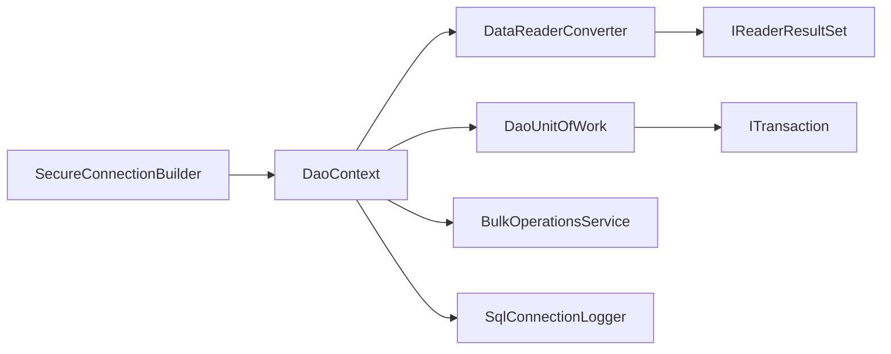
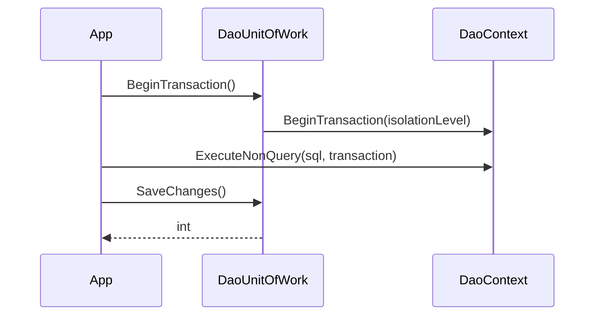

<!-- Mantenido por agentes según AGENTS.md. Puede regenerarse por completo con el prompt de Wiki. -->

# KUtilitiesCore.Dal

> Implementación ADO.NET (SQL Server, `Microsoft.Data.SqlClient`) de las abstracciones de `KUtilitiesCore.DataAccess`: contexto de ejecución, transacciones, Unit of Work, mapeo de `IDataReader`, inserción masiva y logging de mensajes SQL.
> Puntos de entrada: `DaoContext`, `DaoUnitOfWork`, `DataReaderConverter`, `SecureConnectionBuilder`, `BulkOperationsService`.

## 1. Descripción general y propósito

- Namespace raíz: `KUtilitiesCore.Dal`. Namespaces públicos: `.BulkInsert`, `.ConnectionBuilder`, `.Exceptions`, `.Helpers`, `.SQLLog`, `.UOW`.
- Rol: acceso a datos nativo sin ORM. Ejecuta SQL y procedimientos almacenados, mapea resultados a POCOs (`class, new()`) o `DataTable`, y coordina transacciones mediante un Unit of Work que implementa `IUnitOfWork` ([KUtilitiesCore.DataAccess](KUtilitiesCore.DataAccess.md)).
- Patrones evidenciados:

| Patrón | Evidencia |
|---|---|
| Unit of Work + Repository | `UOW/DaoUnitOfWork.cs`, `UOW/DaoRepository.cs` |
| Fluent builder | `Helpers/DataReaderConverter.cs` |
| Template method (`MapParameters`, métodos abstractos) | `UOW/DaoRepository.cs` |
| Null Object | `SQLLog/SqlConnectionLogger.cs` (`NullDisposable`) |
| Hooks de conexión | `ISqlExecutorContext.cs` (`OnConnectionOpened`, `OnConnectionOpenedAsync`) |

- Contenido excluido de la compilación (`Compile Remove` en el csproj), **no forma parte del API**: carpetas `Paging\` y `SPHelper\`, y los archivos `Exceptions/RepositoryException.cs`, `UOW/IDaoRepositoryProvider.cs`, `UOW/IRawRepository.cs`, `UOW/UnregisteredRepositoryException.cs`. `IRawRepository` se consume desde `KUtilitiesCore.DataAccess` (`KUtilitiesCore.DataAccess/UOW/Interfaces/IRawRepository.cs`).

## 2. Guía de inicio rápido

### Ejemplo 1: contexto y lectura tipada

```csharp
using System.Data;
using System.Data.Common;
using KUtilitiesCore.Dal;
using KUtilitiesCore.Dal.ConnectionBuilder;
using KUtilitiesCore.Dal.Helpers;
using Microsoft.Data.SqlClient;

public class Persona
{
    public int Id { get; set; }
    public string? Nombre { get; set; }
}

public static class Ejemplo1
{
    public static List<Persona> Leer()
    {
        // Las pruebas del repositorio registran la fábrica antes de usar DaoContext.
        DbProviderFactories.RegisterFactory("System.Data.SqlClient", SqlClientFactory.Instance);

        var builder = new SecureConnectionBuilder
        {
            ServerName = "localhost",
            InitialCatalog = "MiBase",
            IntegratedSecurity = true,
            Encrypt = true,
            TrustServerCertificate = true
        };

        using var dao = new DaoContext(builder);
        var converter = DataReaderConverter.Create()
            .WithResult<Persona>()
            .SetStrictMapping(false);

        IReaderResultSet rs = dao.ExecuteReader("SELECT Id, Nombre FROM Persona", converter);
        return rs.GetResult<Persona>().ToList();
    }
}
```

### Ejemplo 2: parámetros y escalares

```csharp
using KUtilitiesCore.Dal;

public static class Ejemplo2
{
    public static int Contar(IDaoContext dao, int minimo)
    {
        IDaoParameterCollection p = dao.CreateParameterCollection();
        p.Add<int>("@min", minimo);
        return dao.Scalar<int>("SELECT COUNT(*) FROM Persona WHERE Id >= @min", p);
    }
}
```

### Ejemplo 3: Unit of Work con transacción explícita

```csharp
using KUtilitiesCore.Dal;
using KUtilitiesCore.Dal.UOW;

public static class Ejemplo3
{
    public static void Grabar(IDaoContext dao)
    {
        using var uow = new DaoUnitOfWork(dao);
        using ITransaction tx = uow.BeginTransaction();
        try
        {
            dao.ExecuteNonQuery("UPDATE Persona SET Nombre = 'X' WHERE Id = 1", transaction: tx);
            uow.SaveChanges();
        }
        catch
        {
            uow.Rollback();
            throw;
        }
    }
}
```

### Ejemplo 4: inserción masiva desde objetos

```csharp
using KUtilitiesCore.Dal;
using KUtilitiesCore.Dal.BulkInsert;

public class Fila
{
    public int Id { get; set; }
    public string? Nombre { get; set; }
}

public static class Ejemplo4
{
    public static void Insertar(DaoContext dao, IEnumerable<Fila> filas)
    {
        var config = new BulkOperationsConfig("dbo.Persona") { BatchSize = 500 };
        config.ColumnMappings["Id"] = "Id";
        config.ColumnMappings["Nombre"] = "Nombre";
        new BulkOperationsService(config).BulkInsert(filas, dao);
    }
}
```

### Flujo





## 3. Referencia del API principal

### `KUtilitiesCore.Dal`

| Tipo | Rol | Miembros clave |
|---|---|---|
| `IDalContext : IDisposable` | Contexto base | `ProviderName`, `BeginTransaction(IsolationLevel = Snapshot)`, `DatabaseExists()` |
| `ISqlExecutorContext : IDalContext` | Ejecución SQL | `Connection`, `ConnectionTimeout`, `OnConnectionOpened`, `OnConnectionOpenedAsync`, `CreateParameterCollection()`, `ExecuteNonQuery(Async)`, `Scalar<TResult>(Async)` |
| `IDaoContext : ISqlExecutorContext` | Ejecución ADO.NET completa | `CreateAdapter`, `CreateCommand`, `CreateCommandBuilder`, `ExecuteReader(Async)`, `FillDataSet(Async)`, `UpdateDataSet(Async)` |
| `DaoContext` | Implementación | `DaoContext(IConnectionString cnnStr, ILogger<DaoContext>? logger = null, IMetrics? metrics = null)`; `ExecuteReaderCore`, `ExecuteReaderAsyncCore` |
| `IDaoParameterCollection : IReadOnlyCollection<DbParameter>` | Parámetros | indexador, `Add<TType>(name, value, direction)`, `Add(name, value, DbType, size, scale, precision, direction)`, `Add(name, DbType, direction)`, `Clear`, `Contains`, `GetParamValue<T>`, `Remove` |
| `DaoParameterCollection` | Sealed | `DaoParameterCollection(Func<DbParameter>)` |
| `ITransaction : IDisposable` | Transacción | `Commit()`, `Rollback()` |
| `TransactionBase` | Base | `TransactionBase(DbTransaction)`, `GetTransactionObject()` |
| `DaoContextExt` | Extensiones | `EnableSqlLogging<TDbConnection>`, `GetPublishedServerNameAsync`, `GetServerDateTimeAsync`, `SetSessionContextAsync` |

Todos los métodos de ejecución reciben `(sql, IDaoParameterCollection? = null, CommandType = Text, ITransaction? = null)`; las variantes async añaden `CancellationToken`. `ExecuteReader` recibe además un `IDataReaderConverter` como segundo argumento.

**Hooks de conexión.** `OnConnectionOpened` (`Action<ISqlExecutorContext>?`) se invoca tras abrir la conexión, después del logging SQL y antes de `OnConnectionOpenedAsync` (`Func<ISqlExecutorContext, Task>?`). Fuente: comentarios XML de `ISqlExecutorContext.cs`.

### `KUtilitiesCore.Dal.BulkInsert`

| Tipo | Miembros clave |
|---|---|
| `BulkOperationsConfig` | `BulkOperationsConfig(string destinationTableName)`; `BatchSize = 1000`, `BulkCopyTimeout = 600`, `Options` (`SqlBulkCopyOptions`, por defecto `Default`), `ColumnMappings` (`Dictionary<string,string>`, `OrdinalIgnoreCase`), `DestinationTableName`, `KeyColumnNameForUpdateDelete` |
| `IBulkOperationsService` | `BulkCopy<TContext>(DataTable, TContext, ITransaction? = null)`, `BulkCopy<TContext>(IDataReader, TContext, ITransaction? = null)`, `BulkInsert<T, TContext>(IEnumerable<T>, TContext, ITransaction? = null)`; `TContext : ISqlExecutorContext` |
| `BulkOperationsService(BulkOperationsConfig)` | Implementa lo anterior |
| `ObjectDataReader<T> : IDataReader` | `ObjectDataReader(IEnumerable<T> data)`; expone las propiedades de `T` como columnas; `GetData` lanza `NotSupportedException`; `GetBytes`/`GetChars` devuelven 0 |

`KeyColumnNameForUpdateDelete` está documentado como "para BulkUpdate/BulkDelete", pero `IBulkOperationsService` no declara tales métodos: No determinado su uso efectivo.

### `KUtilitiesCore.Dal.ConnectionBuilder`

| Tipo | Miembros clave |
|---|---|
| `IConnectionString` | `CnnString`, `ProviderName` |
| `IConnectionBuilder : IConnectionString, IDataErrorInfo` | Propiedades con atributos JSON; `CanListDatabases()`, `ListDatabases()`, `Reset()`, `TestConnection()` |
| `IConnectionBuilderPersist` | `Load`, `SaveChanges` |
| `ISecureConnectionBuilder` | Combina las dos anteriores |
| `ConnectionBuilderBase` (abstracta, `INotifyPropertyChanged`) | `ApplicationName`, `ConnectionTimeout`, `Encrypt`, `InitialCatalog`, `IntegratedSecurity`, `Password`, `ProviderName`, `ServerName`, `TrustServerCertificate`, `UserName`, `CustomDefaultConfig`, `IsValid()`, `SetCnnStringProperties(string)`, `GetProviderInvariantNames()` (estático) |
| `SecureConnectionBuilder` | Constructores `()`, `(string connectionString)`, `(IEncryptionService? encryptionService, string filePath = "")` |

### `KUtilitiesCore.Dal.Helpers`

| Tipo | Miembros clave |
|---|---|
| `IDataReaderConverter` / `DataReaderConverter` (sealed) | `Create()`, `GetDefault()`, `SetColumnPrefixesToRemove(params string[])`, `SetStrictMapping(bool)`, `WithDefaultDataTable()`, `WithResult<TResult>()` (`class, new()`), `WithResult<TResult>(Func<DataTable, IEnumerable<TResult>>)`, `BuildReaderResultSet(IDataReader, ref bool moreResultSets)` |
| `IReaderResultSet` | `ParamsUsed`, `HasResultsets`, `ResultSetCount`, `GetResult<TResult>(int index = 0)`, `GetResultUnsafe<TResult>(int index = 0)`, `GetDataTable(int index = 0)`, `GetAllDataTables()` |
| `DataReaderExtensions` | `Translate<T>(this IDataReader)`, `Translate<T>(this IDataReader, TranslateOptions)` (`T : new()`) |
| `TranslateOptions` | `StrictMapping=false`, `RequiredProperties`, `IgnoreMissingColumns=false`, `ColumnPrefixesToRemove` |
| `IgnoreMappingAttribute`, `OptionalMappingAttribute` | Atributos de propiedad para el mapeo |
| `TestConnectionResult` | `Sucess`, `Ex` (`DataAccessException?`), `PublishedServerName`, `ServerVersion`, `SucessTest` (estático), `FailTest(DataAccessException)` |

`ReaderResultSet` es `internal`; se obtiene solo a través de `IReaderResultSet`. Los nombres `Sucess`/`SucessTest` conservan la errata del código.

### `KUtilitiesCore.Dal.Exceptions`

| Tipo | Miembros clave |
|---|---|
| `ConcurrencyException` | Excepción de concurrencia |
| `DataAccessException` | `DataAccessException(message, sql, providerName, inner)` |
| `ErrorHelper` | `Builder.Register`, `RegisterRange`, `Build`; `ThrowIfError` |

### `KUtilitiesCore.Dal.SQLLog`

| Tipo | Miembros clave |
|---|---|
| `SqlLogLevel` | `Info`, `Warning`, `Error`, `Debug` |
| `SqlLoggingOptions` | `MinimumLogLevel=Info`, `IncludeConnectionInfo=true`, `IncludeTimestamp=true`, `FilterSystemMessages=true`, `IgnoredErrorNumbers`, `CustomFilter`, `MaxMessageLength=4000` |
| `SqlLogEntry` | `Timestamp` (UTC), `LogLevel`, `Message`, `Procedure`, `LineNumber`, `ErrorNumber`, `Severity`, `State`, `Server`, `Database`, `ConnectionId`, `ExecutionTime`, `ToString()`, `ToDictionary()` |
| `SqlConnectionLogger : IDisposable` | `Attach(SqlConnection, ...)` estático (devuelve `IDisposable`); `NullDisposable.Instance` |
| `SqlLoggingExtensions` | `EnableSerilogSqlLogging<TConnection>(this TConnection, ILogger, SqlLoggingOptions? = null)` (`TConnection : DbConnection`) |

`DaoContextExt.EnableSqlLogging<TDbConnection>(connection, Action<SqlLogEntry>, SqlLoggingOptions? = null)` solo engancha eventos cuando la conexión es `SqlConnection`.

### `KUtilitiesCore.Dal.UOW`

| Tipo | Miembros clave |
|---|---|
| `DaoUnitOfWork : IUnitOfWork` | `DaoUnitOfWork(IDaoContext)`; `RegisterCustomRepository<TInterface>()` (`IRawRepository`), `RegisterCustomRepository<TEntity, TRepository>()`, `Repository<T>()`, `RawRepository<TRepo>()`, `BeginTransaction(IsolationLevel = ReadCommitted)`, `SaveChanges()`, `SaveChangesAsync()`, `Rollback()`, `Dispose()` |
| `IDaoUowContext` / `DaoUowContext` | `Context`, `Transaction`, `DaoRepositoryProvider`, `Rollback`; `DaoUowContext(IRepositoryProvider, IDaoContext)` |
| `DaoRepositoryReadOnly<T>` (abstracta, `T : class, new()`) | Constructor protegido `(IDaoUowContext)`; protegidos `Context`, `Transaction`, `RepositoryProvider`, `MapParameters(IDictionary<string, object>)`; abstractos `Count(Async)`, `GetEntities(Async)`, `GetFirstOrDefault(Async)` con `ISpecification<T>` |
| `DaoRepository<T>` | Añade abstractos `AddEntity`, `DeleteEntity`, `UpdateEntity` |
| `RawRepositorybase : IRawRepository` | Constructor `(IDaoUowContext)`; protegidos `Context`, `Transaction`, `RepositoryProvider` |

`DefaultDaoRepository<T>` es `internal`. `SaveChanges` "confirma la transacción registrada cuando existe y está viva" (comentario XML de `UOW/DaoUnitOfWork.cs`); el valor devuelto en cada caso se define en ese archivo.

## 4. Dependencias y paquetes

| Paquete | Versión | Notas |
|---|---|---|
| `Microsoft.Data.SqlClient` | 7.1.0 | Único `PackageReference` directo |

| Referencia de proyecto | Wiki |
|---|---|
| `KUtiitiesCore.Encryption/KUtilitiesCore.Encryption.csproj` | [KUtilitiesCore.Encryption](KUtilitiesCore.Encryption.md) |
| `KUtilities.Logger/KUtilitiesCore.Logger.csproj` | [KUtilitiesCore.Logger](KUtilitiesCore.Logger.md) |
| `KUtilitiesCore.DataAccess/KUtilitiesCore.DataAccess.csproj` | [KUtilitiesCore.DataAccess](KUtilitiesCore.DataAccess.md) |
| `KUtilitiesCore/KUtilitiesCore.csproj` | [KUtilitiesCore](KUtilitiesCore.md) |

Acoplamientos notables: `DaoContext` usa `ILogger<DaoContext>` e `IMetrics` (Logger/Telemetry); `SecureConnectionBuilder` usa `IEncryptionService`; los repositorios dependen de `ISpecification<T>` de DataAccess. `SqlConnectionLogger.cs` contiene directivas condicionales con alias `SqlConnectionAlias` (`System.Data.SqlClient` o `Microsoft.Data.SqlClient`); con `net10.0` aplica `Microsoft.Data.SqlClient`.

## 5. Reglas de arquitectura y restricciones

| Regla | Evidencia |
|---|---|
| `Paging\` y `SPHelper\` no se compilan; no usarlos ni documentarlos como API | `KUtilitiesCore.Dal/KUtilitiesCore.Dal.csproj` |
| `IDaoRepositoryProvider`, `IRawRepository` (local) y `UnregisteredRepositoryException` locales están excluidos; el contrato vigente vive en DataAccess | `KUtilitiesCore.Dal/KUtilitiesCore.Dal.csproj`, `KUtilitiesCore.DataAccess/UOW/Interfaces/IRawRepository.cs` |
| Los repositorios exigen entidades `class, new()` | `KUtilitiesCore.Dal/UOW/DaoRepository.cs` |
| Nullable habilitado (a diferencia de DataAccess) | `KUtilitiesCore.Dal/KUtilitiesCore.Dal.csproj` |
| Los hooks de conexión se ejecutan en orden: logging SQL, `OnConnectionOpened`, `OnConnectionOpenedAsync` | `KUtilitiesCore.Dal/ISqlExecutorContext.cs` |
| `TContext` de las operaciones masivas debe ser `ISqlExecutorContext` | `KUtilitiesCore.Dal/BulkInsert/IBulkOperationsService.cs` |

### Qué NO hacer

- No crear instancias de `ReaderResultSet` ni `DefaultDaoRepository<T>` (son `internal`).
- No referenciar `Paging` ni `SPHelper` de este proyecto: están fuera de la compilación.
- No asumir que `SaveChanges()` confirma sin una transacción registrada con `BeginTransaction`.
- No usar `GetResultUnsafe<TResult>` si el resultado no se mapeó con el delegado de `WithResult`: lanza `InvalidCastException` (`Helpers/ReaderResultSet.cs`).

### Puntos de extensión

- Heredar `DaoRepository<T>` / `DaoRepositoryReadOnly<T>` e implementar los miembros abstractos; registrar con `RegisterCustomRepository<TEntity, TRepository>()`.
- Heredar `RawRepositorybase` para consultas no mapeadas a entidades; registrar con `RegisterCustomRepository<TInterface>()`.
- Implementar `IConnectionBuilder` o heredar `ConnectionBuilderBase`.
- Asignar `OnConnectionOpened` / `OnConnectionOpenedAsync` para inicializar la sesión (por ejemplo `SetSessionContextAsync`).
- Personalizar el mapeo con `WithResult<TResult>(Func<DataTable, IEnumerable<TResult>>)`, `IgnoreMappingAttribute` y `OptionalMappingAttribute`.
