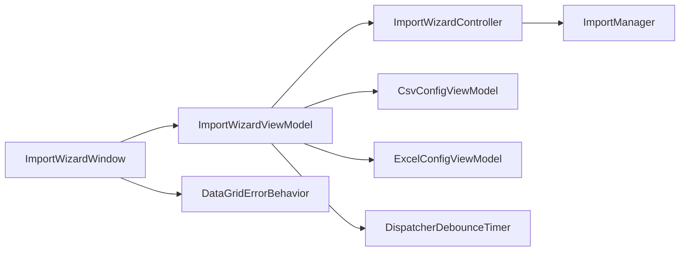
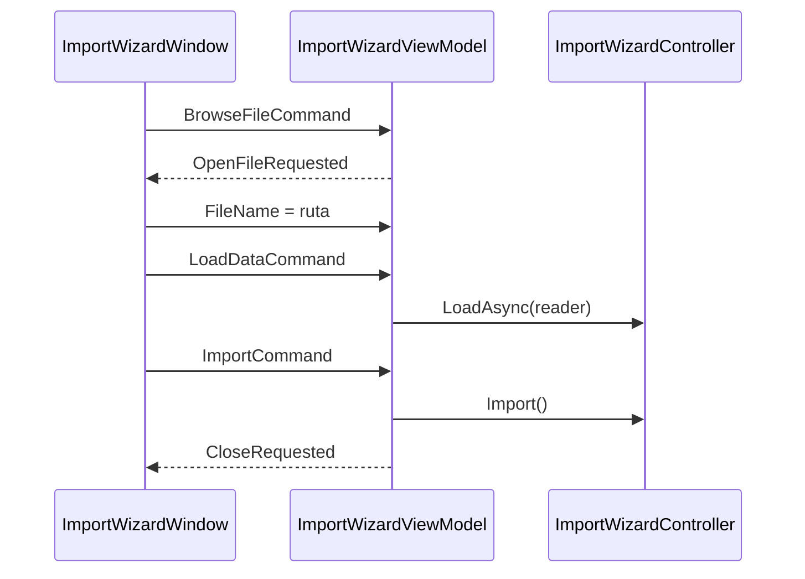

<!-- Mantenido por agentes según AGENTS.md. Puede regenerarse por completo con el prompt de Wiki. -->

# KUtilitiesCore.Data.WPF

> Asistente de importación de datos para WPF (ventana, ViewModels MVVM, comportamiento de errores en `DataGrid`), diálogo de exportación y servicio de mensajes propio.
> Puntos de entrada: `ImportWizardWindow`, `ImportWizardViewModel`, `Exporter.ShowExportDataDialog` y `WpfMessageService`.

## 1. Descripción general y propósito

- Namespace raíz: `KUtilitiesCore.Data.WPF`. Namespaces públicos adicionales: `.Importer` y `.MessageService`.
- Rol: equivalente WPF de [KUtilitiesCore.Data.Win](KUtilitiesCore.Data.Win.md). Reutiliza el orquestador de [KUtilitiesCore.Data.Wizard](KUtilitiesCore.Data.Wizard.md) y los lectores/validación de [KUtilitiesCore.Data](KUtilitiesCore.Data.md); la capa MVVM viene de [KUtilitiesCore.MVVM](KUtilitiesCore.MVVM.md) (`ViewModelHelperBase`, `RelayCommand<T>`, `ISupportMessageService`).
- `ImportWizardViewModel` envuelve un `ImportWizardController` (propiedad `Controller`) y expone comandos y estado enlazables; `ImportWizardWindow` es la vista.
- Los archivos `.xaml` y `.xaml.cs` son vistas; su API pública se limita a los constructores y propiedades indicados en la sección 3.

## 2. Guía de inicio rápido

### Ejemplo 1: abrir el asistente de importación

```csharp
using System.Data;
using KUtilitiesCore.Data.ImportDefinition;
using KUtilitiesCore.Data.WPF.Importer;

public static class Ejemplo1
{
    public static DataTable? Importar(string rutaArchivo)
    {
        var definiciones = new FieldDefinitionCollection();
        definiciones.Add("Name", "Nombre");
        definiciones.Add("Edad", "Edad", fieldType: typeof(int));

        var ventana = new ImportWizardWindow(definiciones)
        {
            FileName = rutaArchivo
        };
        ventana.ShowDialog();
        return ventana.ResultData;
    }
}
```

### Ejemplo 2: exportar con diálogo

```csharp
using System.Data;
using KUtilitiesCore.Data.WPF;

public static class Ejemplo2
{
    public static bool Exportar(DataTable tabla) =>
        tabla.ShowExportDataDialog("Guardar listado", "Listado");
}
```

### Ejemplo 3: mensajes con el servicio WPF

```csharp
using KUtilitiesCore.Data.WPF.MessageService;
using KUtilitiesCore.MVVM.MessageService;

public static class Ejemplo3
{
    public static async Task AvisarAsync()
    {
        var servicio = new WpfMessageService();
        await servicio.ShowInfoAsync("Operación completada.");

        bool acepta = await servicio.ConfirmAsync(new MessageArgs
        {
            Caption = "Confirmar",
            Message = "¿Reemplazar los datos existentes?",
            MessageType = MessageType.Warning,
            MessageIcon = MessageIcon.Question
        });
        if (acepta)
            await servicio.ShowSuccessAsync("Datos reemplazados.");
    }
}
```

### Flujo





## 3. Referencia del API principal

### `KUtilitiesCore.Data.WPF`

| Tipo | Miembros |
|---|---|
| `Exporter` (static) | `static bool ShowExportDataDialog(this DataTable dt, string titleDialog = "Guardar exportación de datos.", string defaulFilename = "")`; `static string GetSeparator(string fileName)` |

### `KUtilitiesCore.Data.WPF.Importer`

| Tipo | Miembros |
|---|---|
| `ImportWizardWindow : Window` | Constructor `(FieldDefinitionCollection fieldDefinitions, ImportManager? importManager = null, ISupportMessageService? messageService = null)`; `ViewModel`, `ResultData`, `AutoCloseOnSuccess`, `FileName` |
| `ImportWizardViewModel : ViewModelHelperBase, IDisposable` | Constructor `(FieldDefinitionCollection fieldDefinitions, ImportManager? importManager = null, IWizardDebounceTimer? debounceTimer = null, ISupportMessageService? messageService = null)`; eventos `OpenFileRequested`, `CloseRequested`; `Controller`; comandos `BrowseFileCommand`, `LoadDataCommand`, `ImportCommand` (`RelayCommand<ImportWizardViewModel>`); propiedades `AutoCloseOnSuccess`, `FileName`, `CurrentConfig`, `LoadedDataView`, `ResultData`, `IsDataStale`, `RowErrors`, `CanImport`, `LoadedRowCount`, `StatusMessage`, `ShowErrorsOnly`, `Mapping`; métodos `LoadDataAsync()`, `ImportData()`, `Revalidate()`, `ScheduleSilentRevalidation()`, `CanBrowseFile()`, `CanLoadData()`, `CanImportData()`, `Dispose()`; protegido virtual `CreateReader()` |
| `ConfigViewModelBase : INotifyPropertyChanged, IImportConfigControl` (abstracta) | `OptionsChanged`, `PropertyChanged`, `Initialize(string)` y `GetParsingOptions()` abstractos; protegidos `RaisePropertyChanged`, `SetProperty<T>`, `SuppressOptionsChanged(Action)` |
| `CsvConfigViewModel` (sealed) | `DefaultDelimiterOptions` (estática), `SelectedDelimiter`, `HasHeader`, `TrimValues`, `IgnoreEmptyLines` |
| `ExcelConfigViewModel` (sealed) | `Sheets` (`ObservableCollection<string>`), `SelectedSheet`, `HasHeader`, `StartRow`, `EndRow` (0 = hasta el final) |
| `CsvConfigControl`, `ExcelConfigControl` (`UserControl`) | Vistas XAML, constructor sin parámetros |
| `DelimiterOption` (sealed) | `DelimiterOption(string label, string value)`; `Label`, `Value` |
| `FieldMappingItem : INotifyPropertyChanged` (sealed) | `IgnoreSourceColumn = "(Ignorar)"`; `FieldName`, `DisplayName`, `Description`, `AvailableSourceColumns`, `SelectedSourceColumn` |
| `DataGridErrorBehavior` (static) | `EnabledProperty`, `GetEnabled`, `SetEnabled`, `Refresh(DataGrid)` |
| `RowErrorDescriptor` (static) / `CellErrorDescriptor` | `Describe(DataRow)` → `IReadOnlyList<CellErrorDescriptor>`; `CellErrorDescriptor(string columnName, string message)` |
| `WizardRowErrorIndexConverter : IValueConverter` (sealed) | `NoRowIndexText = "-"`; `Convert`, `ConvertBack` |
| `DispatcherDebounceTimer : IWizardDebounceTimer` (sealed) | `Elapsed`, `Start(int)`, `Stop()` |

### `KUtilitiesCore.Data.WPF.MessageService`

| Tipo | Miembros |
|---|---|
| `WpfMessageService : ISupportMessageService` (sealed) | `ShowInfoAsync`, `ShowWarningAsync`, `ShowSuccessAsync`, `ShowErrorAsync` (`string` → `ValueTask`), `ShowAsync(MessageArgs)`, `ConfirmAsync(MessageArgs)` (`ValueTask<bool>`) |
| `MessageDialogModel` (sealed) | `Caption`, `Heading`, `Message`, `Footnote`, `Expander`, `MessageType`, `MessageIcon`, `IsConfirmation`, `ShowHeading`, `ShowFootnote`, `ShowExpander`, `ShowIcon`; `static FromArgs(MessageArgs, bool isConfirmation = false)` |
| `MessageDialogWindow : Window` | `MessageDialogWindow(MessageDialogModel model)` |

`MessageArgs`, `MessageType` (`Generic`, `Information`, `Warning`, `Error`) y `MessageIcon` (`None`, `Information`, `Warning`, `Error`, `Question`) viven en `KUtilitiesCore.MVVM.MessageService`.

## 4. Dependencias y paquetes

No hay `PackageReference` directos. Usa `UseWPF=true`.

| Referencia de proyecto | Wiki |
|---|---|
| `KUtilitiesCore.Data.Wizard/KUtilitiesCore.Data.Wizard.csproj` | [KUtilitiesCore.Data.Wizard](KUtilitiesCore.Data.Wizard.md) |
| `KUtilitiesCore.Data/KUtilitiesCore.Data.csproj` | [KUtilitiesCore.Data](KUtilitiesCore.Data.md) |
| `KUtilitiesCore.MVVM/KUtilitiesCore.MVVM.csproj` | [KUtilitiesCore.MVVM](KUtilitiesCore.MVVM.md) |

Acoplamientos notables: solo Windows (`net10.0-windows`). A diferencia de la variante WinForms, este proyecto depende de MVVM (comandos, `ViewModelHelperBase`, servicio de mensajes).

## 5. Reglas de arquitectura y restricciones

| Regla | Evidencia |
|---|---|
| El estado del asistente vive en `ImportWizardController`; el ViewModel lo proyecta | `Importer/ImportWizardViewModel.cs` (`Controller`, propiedades delegadas) |
| El ViewModel no abre diálogos: lanza `OpenFileRequested` / `CloseRequested` para que el host actúe | `Importer/ImportWizardViewModel.cs` |
| `CanImport` exige además que `RowErrors` esté vacío | `Importer/ImportWizardViewModel.cs` |
| El debounce se implementa con `DispatcherDebounceTimer` | `Importer/DispatcherDebounceTimer.cs` |
| Los diálogos de mensaje se construyen desde un modelo puro (`MessageDialogModel`) | `MessageService/MessageDialogModel.cs` |

### Qué NO hacer

- No usar la ventana ni los ViewModels fuera del hilo del `Dispatcher`.
- No acceder a `ResultData` esperando datos si `CanImport` es `false`.
- No mezclar esta capa con `KUtilitiesCore.Data.Win` en la misma ventana: usan controles de configuración distintos.
- No poner lógica de validación en `ImportWizardWindow`; pertenece al controlador y a las definiciones de campo.

### Puntos de extensión

- Heredar `ImportWizardViewModel` y sobrescribir `CreateReader()`.
- Heredar `ConfigViewModelBase` para añadir configuraciones de nuevos formatos.
- Inyectar un `ISupportMessageService` propio en `ImportWizardWindow` / `ImportWizardViewModel`.
- Inyectar `IWizardDebounceTimer` o `ImportManager` personalizados en el constructor del ViewModel.
