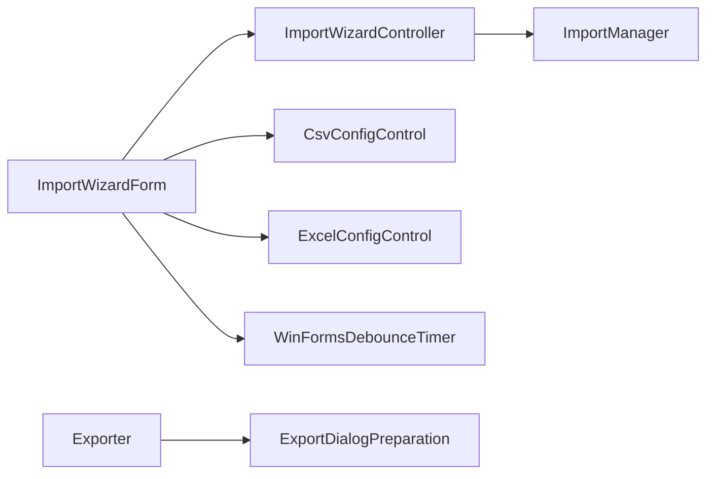
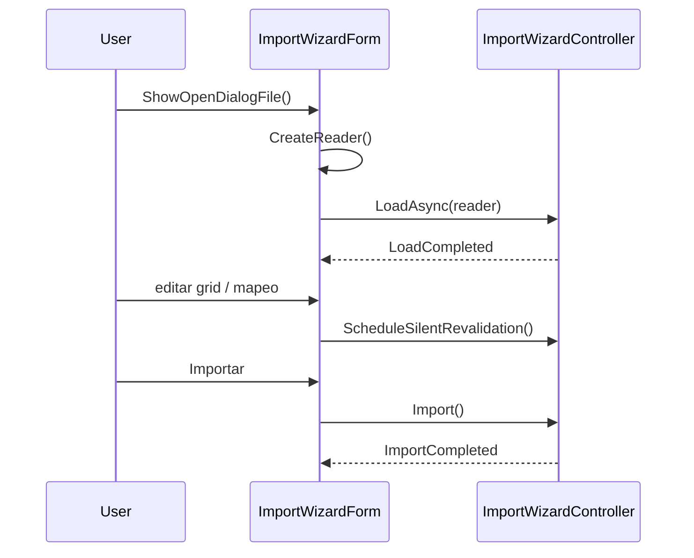

<!-- Mantenido por agentes según AGENTS.md. Puede regenerarse por completo con el prompt de Wiki. -->

# KUtilitiesCore.Data.Win

> Componentes Windows Forms para importar y exportar datos: asistente de importación (`ImportWizardForm`), controles de configuración CSV/Excel y diálogo de exportación.
> Puntos de entrada: `ImportWizardForm` y la extensión `Exporter.ShowExportDataDialog`.

## 1. Descripción general y propósito

- Namespace raíz: `KUtilitiesCore.Data.Win`. Namespace público adicional: `.Importer`.
- Rol: capa de presentación WinForms sobre [KUtilitiesCore.Data.Wizard](KUtilitiesCore.Data.Wizard.md) (orquestación, `ImportWizardController`) y [KUtilitiesCore.Data](KUtilitiesCore.Data.md) (lectores, validación y exportación).
- El formulario delega el estado y la validación en `ImportWizardController`; la vista solo enlaza controles (`DataGridView`, controles de configuración) y diálogos.
- Archivos de código generado (`*.Designer.cs`, `Properties/Resources.Designer.cs`) existen en el proyecto y no se documentan. `KUtilitiesCore.Data.Win.csproj.user` es un archivo de IDE y no se lee.

## 2. Guía de inicio rápido

### Ejemplo 1: asistente de importación

```csharp
using System.Data;
using System.Windows.Forms;
using KUtilitiesCore.Data.ImportDefinition;
using KUtilitiesCore.Data.Win.Importer;

public static class Ejemplo1
{
    public static DataTable? Importar(IWin32Window? owner, string rutaArchivo)
    {
        var definiciones = new FieldDefinitionCollection();
        definiciones.Add("Name", "Nombre");
        definiciones.Add("Edad", "Edad", fieldType: typeof(int));

        using var form = new ImportWizardForm(definiciones)
        {
            FileName = rutaArchivo,
            AutoCloseOnSuccess = true
        };
        form.ShowDialog(owner);
        return form.ResultData;
    }
}
```

### Ejemplo 2: exportar con diálogo

```csharp
using System.Data;
using KUtilitiesCore.Data;
using KUtilitiesCore.Data.Win;

public static class Ejemplo2
{
    public static bool Exportar(DataTable tabla)
    {
        tabla.SetDisplayFormat("Fecha", "yyyy-MM-dd");   // solo si existe la columna "Fecha"
        return tabla.ShowExportDataDialog("Guardar listado", "Listado");
    }
}
```

### Ejemplo 3: extender el asistente

```csharp
using System.Windows.Forms;
using KUtilitiesCore.Data.DataImporter;
using KUtilitiesCore.Data.ImportDefinition;
using KUtilitiesCore.Data.Win.Importer;

public sealed class MiAsistente : ImportWizardForm
{
    public MiAsistente(FieldDefinitionCollection campos) : base(campos) { }

    protected override void HandleLoadError(Exception ex)
    {
        MessageBox.Show(ex.Message, "Importación", MessageBoxButtons.OK, MessageBoxIcon.Error);
    }
}
```

### Flujo





## 3. Referencia del API principal

### `KUtilitiesCore.Data.Win`

| Tipo | Miembros |
|---|---|
| `Exporter` (static) | `static bool ShowExportDataDialog(this DataTable dt, string titleDialog = "Guardar exportación de datos.", string defaulFilename = "")`; `static string GetSeparator(string fileName)` |

`ShowExportDataDialog` rechaza tablas sin filas antes de abrir el diálogo (`ExportDialogPreparation.ValidateSource`) y delega el formato en `ExportDialogPreparation` / `ToCsv` / `ToExcel`. El parámetro se llama `defaulFilename` (errata conservada en el API).

### `KUtilitiesCore.Data.Win.Importer`

| Tipo | Miembros |
|---|---|
| `ImportWizardForm : Form` (partial) | `ImportWizardForm(FieldDefinitionCollection fieldDefinitions, ImportManager? importManager = null)`; `AutoCloseOnSuccess = true`, `FileName`, `LoadedDataTable` (setter protegido), `ResultData`; `LoadData()`, `LoadDataAsync()`, `ShowOpenDialogFile()` (públicos virtuales); protegidos virtuales `CreateReader()` (`IDataSourceReader?`), `HandleLoadError(Exception)`, `ImportData()`, `RevalidateAfterEdit()`, `OnProcessImportFinished()`, `ShowMessage(string, string, MessageBoxIcon)`, `OnConfigOptionsChanged(object?, EventArgs)`, `FilterHasErrors(DataTable, DataGridView, bool)`, `ResetWizardState()`; protegido no virtual `ScheduleSilentRevalidation()` |
| `IImportConfigControl` | Hereda `KUtilitiesCore.Data.Wizard.Configuration.IImportConfigControl` sin añadir miembros |
| `CsvConfigControl : UserControl, IImportConfigControl` | `OptionsChanged`, `Initialize(string)`, `GetParsingOptions()`; `SetTrimValuesForTesting(bool)`, `SetIgnoreEmptyLinesForTesting(bool)` |
| `ExcelConfigControl : UserControl, IImportConfigControl` | `OptionsChanged`, `async void Initialize(string)`, `GetParsingOptions()`; `AddSheetForTesting(string)`, `SelectSheetForTesting(int)`, `SetRowRangeForTesting(int, int)` |
| `WinFormsDebounceTimer : IWizardDebounceTimer, IDisposable` (sealed) | `WinFormsDebounceTimer()`, `Elapsed`, `Start(int)`, `Stop()`, `Dispose()` |

Los métodos `*ForTesting` son públicos y existen para pruebas automatizadas; no son API de producción. `TableDataSourceReader` es un tipo anidado privado de `ImportWizardForm`.

## 4. Dependencias y paquetes

No hay `PackageReference` directos. Usa `UseWindowsForms=true` y `GenerateResourceUsePreserializedResources=true`.

| Referencia de proyecto | Wiki |
|---|---|
| `KUtilitiesCore.Data/KUtilitiesCore.Data.csproj` | [KUtilitiesCore.Data](KUtilitiesCore.Data.md) |
| `KUtilitiesCore.Data.Wizard/KUtilitiesCore.Data.Wizard.csproj` | [KUtilitiesCore.Data.Wizard](KUtilitiesCore.Data.Wizard.md) |

Acoplamientos notables: solo compila y ejecuta en Windows (`net10.0-windows`); depende de `FieldDefinitionCollection` y `ImportManager` para el mapeo.

## 5. Reglas de arquitectura y restricciones

| Regla | Evidencia |
|---|---|
| La lógica de carga, validación y debounce vive en `ImportWizardController`, no en el formulario | `Importer/ImportWizardForm.cs`, `Importer/WinFormsDebounceTimer.cs` |
| Los controles de configuración implementan el contrato compartido `IImportConfigControl` | `Importer/IImportConfigControl.cs` |
| La exportación valida primero que la tabla tenga filas | `Exporter.cs` |
| El proyecto requiere Windows | `KUtilitiesCore.Data.Win.csproj` (`net10.0-windows`, `UseWindowsForms`) |

### Qué NO hacer

- No llamar a `ShowOpenDialogFile`, `ShowExportDataDialog` ni `ShowDialog` fuera del hilo de UI.
- No usar los métodos `*ForTesting` en código de producción.
- No poner reglas de validación en el formulario: pertenecen a las definiciones (`FieldDefinitionCollection`) y al controlador.
- No editar a mano los archivos `*.Designer.cs`.

### Puntos de extensión

- Heredar `ImportWizardForm` y sobrescribir `CreateReader`, `HandleLoadError`, `ShowMessage`, `ImportData`, `OnProcessImportFinished`.
- Implementar `IImportConfigControl` para añadir paneles de configuración de otros formatos.
- Inyectar un `ImportManager` propio en el constructor del formulario.
