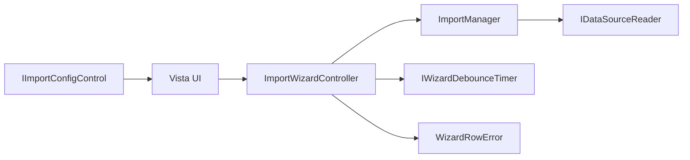
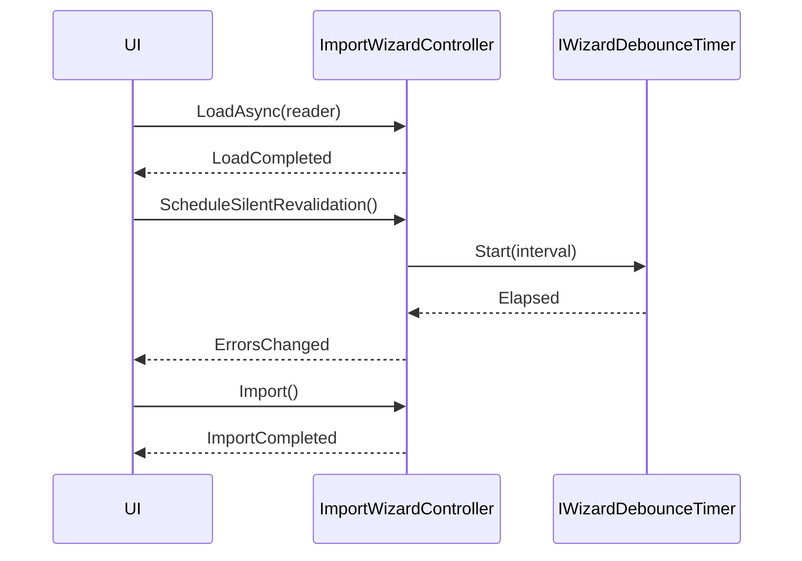

<!-- Mantenido por agentes según AGENTS.md. Puede regenerarse por completo con el prompt de Wiki. -->

# KUtilitiesCore.Data.Wizard

> Orquestación compartida del asistente de importación de datos, agnóstica del framework de interfaz: carga, revalidación con debounce, exposición neutral de errores e importación final.
> Punto de entrada: `ImportWizardController`.

## 1. Descripción general y propósito

- Namespace raíz: `KUtilitiesCore.Data.Wizard`. Namespace público adicional: `.Configuration`.
- Rol: encapsula el ciclo de vida de un asistente de importación sobre `ImportManager` ([KUtilitiesCore.Data](KUtilitiesCore.Data.md)). Las vistas (WinForms o WPF) se limitan a enlazar sus controles con el controlador. Consumido por [KUtilitiesCore.Data.Win](KUtilitiesCore.Data.Win.md) y [KUtilitiesCore.Data.WPF](KUtilitiesCore.Data.WPF.md).
- El proyecto no contiene UI ni temporizadores concretos: el debounce se inyecta mediante `IWizardDebounceTimer`.
- Archivos: `ImportWizardController.cs`, `ImportCompletedEventArgs.cs`, `LoadFailedEventArgs.cs`, `WizardRowError.cs`, `IWizardDebounceTimer.cs`, `Configuration/IImportConfigControl.cs`.

## 2. Guía de inicio rápido

### Ejemplo 1: cargar y consultar el estado

```csharp
using KUtilitiesCore.Data.DataImporter;
using KUtilitiesCore.Data.ImportDefinition;
using KUtilitiesCore.Data.Wizard;

public static class Ejemplo1
{
    public static async Task<bool> CargarAsync(string rutaCsv)
    {
        var definiciones = new FieldDefinitionCollection();
        definiciones.Add("Name", "Nombre");
        definiciones.Add("Edad", "Edad", fieldType: typeof(int));

        using var controller = new ImportWizardController(definiciones);
        controller.FileName = rutaCsv;

        bool cargado = await controller.LoadAsync(new CsvSourceReader(rutaCsv));
        return cargado && controller.CanImport;
    }
}
```

### Ejemplo 2: importar y reaccionar a los eventos

```csharp
using KUtilitiesCore.Data.DataImporter;
using KUtilitiesCore.Data.ImportDefinition;
using KUtilitiesCore.Data.Wizard;

public static class Ejemplo2
{
    public static void Importar(FieldDefinitionCollection definiciones, string rutaCsv)
    {
        using var controller = new ImportWizardController(definiciones);
        controller.LoadFailed += (_, e) => Console.WriteLine($"Fallo de carga: {e.Exception.Message}");
        controller.ErrorsChanged += (_, _) =>
        {
            foreach (WizardRowError error in controller.RowErrors)
                Console.WriteLine($"Fila {error.RowIndex} / {error.FieldDisplayName}: {error.Message}");
        };

        if (!controller.Load(new CsvSourceReader(rutaCsv)))
            return;

        ImportCompletedEventArgs resultado = controller.Import();
        Console.WriteLine(resultado.IsValid
            ? $"Filas importadas: {controller.ResultData?.Rows.Count}"
            : $"Errores: {resultado.ErrorCount}");
    }
}
```

### Ejemplo 3: temporizador de debounce propio

```csharp
using KUtilitiesCore.Data.Wizard;

public sealed class TemporizadorSimple : IWizardDebounceTimer, IDisposable
{
    private readonly System.Timers.Timer _timer = new() { AutoReset = false };

    public TemporizadorSimple() => _timer.Elapsed += (_, _) => Elapsed?.Invoke(this, EventArgs.Empty);

    public event EventHandler? Elapsed;

    public void Start(int intervalMilliseconds)
    {
        _timer.Stop();
        _timer.Interval = intervalMilliseconds;
        _timer.Start();
    }

    public void Stop() => _timer.Stop();

    public void Dispose() => _timer.Dispose();
}
```

### Flujo





## 3. Referencia del API principal

### `KUtilitiesCore.Data.Wizard`

| Tipo | Miembros |
|---|---|
| `ImportWizardController : IDisposable` (sealed) | Constructor `(FieldDefinitionCollection fieldDefinitions, ImportManager? importManager = null, IWizardDebounceTimer? debounceTimer = null)`; constantes `DefaultDebounceIntervalMilliseconds = 400`, `HasErrorColumnName = "_HasError"`; propiedades `FileName` (lectura/escritura), `LoadedDataView` (`DataView?`), `IsLoading`, `IsDataStale`, `ResultData` (`DataTable?`), `CanImport`, `RowErrors` (`IReadOnlyList<WizardRowError>`), `ActiveDefinitionsResolver` (`Func<FieldDefinitionCollection>?`) |
| Eventos | `LoadCompleted` (`EventHandler`), `LoadFailed` (`EventHandler<LoadFailedEventArgs>`), `ImportCompleted` (`EventHandler<ImportCompletedEventArgs>`), `ErrorsChanged` (`EventHandler`) |
| Métodos | `bool Load(IDataSourceReader)`, `Task<bool> LoadAsync(IDataSourceReader)`, `void Reset()`, `bool Revalidate()`, `static DataView CreateErrorsOnlyView(DataTable)`, `void ScheduleSilentRevalidation()`, `void InvalidateData()`, `void DiscardResult()`, `ImportCompletedEventArgs Import()`, `void Dispose()` |
| `ImportCompletedEventArgs : EventArgs` (sealed) | `ImportCompletedEventArgs(bool isValid, int errorCount)`; `IsValid`, `ErrorCount` |
| `LoadFailedEventArgs : EventArgs` (sealed) | `LoadFailedEventArgs(Exception exception)`; `Exception` |
| `WizardRowError` (sealed) | `WizardRowError(int rowIndex, string fieldName, string fieldDisplayName, string message)`; `RowIndex` (-1 sin fila), `FieldName`, `FieldDisplayName`, `Message` |
| `IWizardDebounceTimer` | `event EventHandler? Elapsed`, `void Start(int intervalMilliseconds)`, `void Stop()` |

Comportamiento verificado en `KUtilitiesCore.Data.WPFTests/Wizard/ImportWizardControllerTests.cs`: tras `LoadAsync` la tabla del lector se adopta sin clonar y `LoadedDataView.Table` es esa misma instancia; una segunda carga mientras `IsLoading` es `true` devuelve `false` y no lee la fuente; asignar `FileName = string.Empty` reinicia el estado (`LoadedDataView` y `ResultData` pasan a `null`, `CanImport` a `false`).

### `KUtilitiesCore.Data.Wizard.Configuration`

| Tipo | Miembros |
|---|---|
| `IImportConfigControl` | `event EventHandler? OptionsChanged`, `void Initialize(string fileName)`, `IParsingOptions GetParsingOptions()` |

## 4. Dependencias y paquetes

No hay `PackageReference` directos.

| Referencia de proyecto | Wiki |
|---|---|
| `KUtilitiesCore.Data/KUtilitiesCore.Data.csproj` | [KUtilitiesCore.Data](KUtilitiesCore.Data.md) |

Acoplamientos notables: usa `ImportManager`, `IDataSourceReader`, `IParsingOptions` (Data) y `FieldDefinitionCollection` (KUtilitiesCore, de forma transitiva). No referencia WinForms ni WPF.

## 5. Reglas de arquitectura y restricciones

| Regla | Evidencia |
|---|---|
| Agnóstico de UI: el debounce se inyecta por `IWizardDebounceTimer` | `IWizardDebounceTimer.cs`, `KUtilitiesCore.Data.Wizard.csproj` (sin referencias de UI) |
| Solo una carga simultánea; la segunda devuelve `false` | `ImportWizardController.cs`, `KUtilitiesCore.Data.WPFTests/Wizard/ImportWizardControllerTests.cs` |
| La tabla cargada no se clona; el controlador no la dispone en `Reset` | `ImportWizardController.cs` (comentario de `Reset`), tests |
| `Dispose` libera el debounce, el resultado tipado y el `ImportManager` | `ImportWizardController.cs` (comentario de `Dispose`) |

### Qué NO hacer

- No añadir referencias a WinForms/WPF en este proyecto.
- No modificar `DataView`/`DataTable` expuestos desde otro hilo: los eventos se disparan en el contexto del llamador.
- No asumir que `ResultData` existe sin llamar antes a `Import()` o `Revalidate()`; es `null` si la última validación falló.
- No usar el nombre de columna `_HasError` en las tablas de origen: está reservado (`HasErrorColumnName`).

### Puntos de extensión

- Implementar `IWizardDebounceTimer` con el temporizador del framework de UI.
- Implementar `IImportConfigControl` en los paneles de configuración CSV/Excel de cada UI.
- Asignar `ActiveDefinitionsResolver` para que la revalidación use el mapeo activo de la vista.
- Inyectar un `ImportManager` preconfigurado en el constructor.
