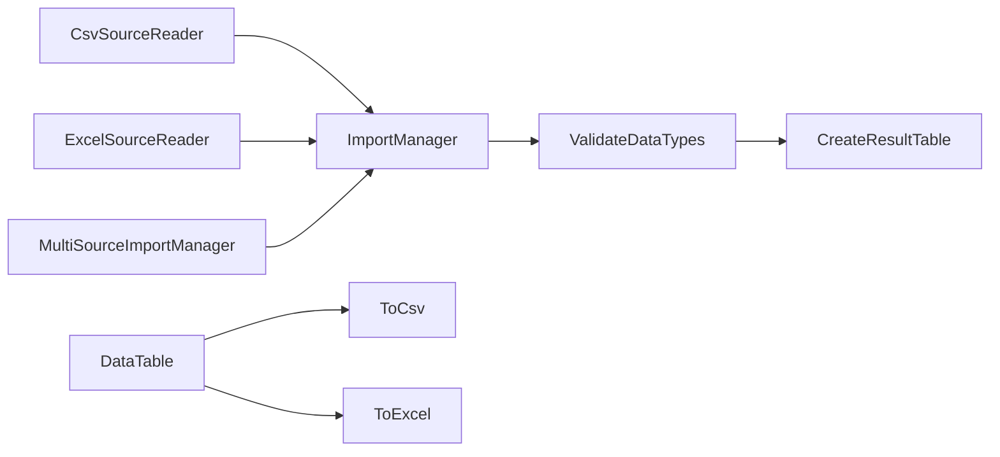
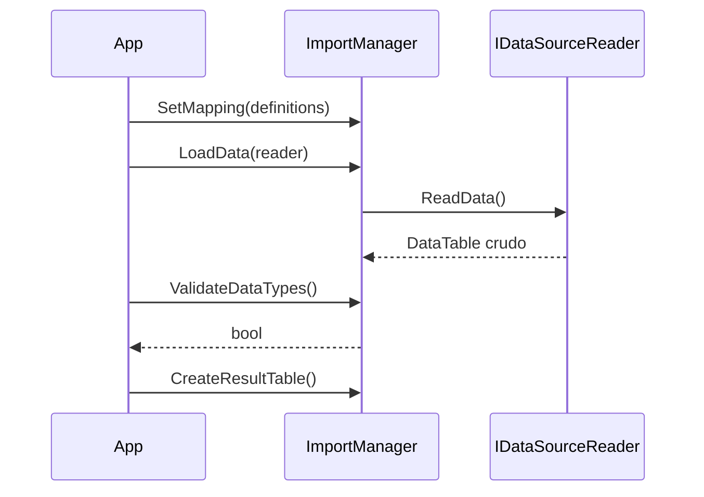

<!-- Mantenido por agentes según AGENTS.md. Puede regenerarse por completo con el prompt de Wiki. -->

# KUtilitiesCore.Data

> Importación y exportación de datos tabulares (`DataTable`) en CSV/TSV/PSV y Excel (`.xlsx`, con ClosedXML), sin dependencias de UI.
> Puntos de entrada: `ImportManager`, `MultiSourceImportManager`, `CsvSourceReaderFactory`, `ExcelSourceReaderFactory`, `ToCsv` / `ToExcel` y `DataTableExt`.

## 1. Descripción general y propósito

- Namespace raíz: `KUtilitiesCore.Data`. Namespaces públicos: `.DataExporter`, `.DataImporter`, `.DataImporter.Interfaces`, `.DataImporter.Infraestructure.ClosedXml` y `.DataImporter.Infrastructure` (dos grafías en el código; ver sección 5).
- Rol: lee orígenes (CSV o Excel) a un `DataTable` crudo, lo valida contra un esquema `FieldDefinitionCollection` (definido en [KUtilitiesCore](KUtilitiesCore.md), namespace `KUtilitiesCore.Data.ImportDefinition`) y produce una tabla tipada; y exporta un `DataTable` a CSV o Excel respetando metadatos de columna.
- Los metadatos de columna (descripción, formato, ancho Excel, exclusión) se guardan en `DataColumn.ExtendedProperties` mediante `DataTableExt`.
- Compilación excluida: `DataImporter\Helpers\**` (csproj, `Compile Remove`). No es parte del API.
- Los proyectos de interfaz [KUtilitiesCore.Data.Wizard](KUtilitiesCore.Data.Wizard.md), [KUtilitiesCore.Data.Win](KUtilitiesCore.Data.Win.md) y [KUtilitiesCore.Data.WPF](KUtilitiesCore.Data.WPF.md) se apoyan en este proyecto.

## 2. Guía de inicio rápido

### Ejemplo 1: exportar a CSV y Excel

```csharp
using System.Data;
using KUtilitiesCore.Data;
using KUtilitiesCore.Data.DataExporter;

public static class Ejemplo1
{
    public static void Exportar(string rutaCsv, string rutaXlsx)
    {
        var tabla = new DataTable("Personas");
        tabla.AddColumn<int>("Id", "Identificador");
        tabla.AddColumn<string>("Nombre", "Nombre completo", description: "Nombre y apellido");
        tabla.AddColumn<string>("Notas", excludeColumnFlag: true);   // no se exporta
        tabla.Rows.Add(1, "Ana Pérez", "interno");

        tabla.ToCsv(rutaCsv, openFile: false);
        tabla.ToExcel(rutaXlsx, openFile: false);
    }
}
```

### Ejemplo 2: importar un CSV con validación

```csharp
using System.Data;
using KUtilitiesCore.Data.DataImporter;
using KUtilitiesCore.Data.ImportDefinition;

public static class Ejemplo2
{
    public static DataTable? Importar(string rutaCsv)
    {
        var mapping = new FieldDefinitionCollection();
        mapping.Add("Name", "Nombre");
        mapping.Add("Edad", "Edad", fieldType: typeof(int));

        using var manager = new ImportManager();
        manager.SetMapping(mapping);
        manager.LoadData(new CsvSourceReader(rutaCsv));

        if (!manager.ValidateDataTypes())
        {
            foreach (var error in manager.ValidationErrors.Errors)
                Console.WriteLine(error);
            return null;
        }
        return manager.CreateResultTable();
    }
}
```

### Ejemplo 3: leer una hoja de Excel

```csharp
using System.Data;
using KUtilitiesCore.Data.DataImporter;

public static class Ejemplo3
{
    public static DataTable LeerHoja(string rutaXlsx)
    {
        IReadOnlyList<string> hojas = ExcelSourceReaderFactory.GetSheets(rutaXlsx);
        using var lector = ExcelSourceReaderFactory.Create(rutaXlsx, hojas[0]);
        return lector.ReadData();
    }
}
```

### Ejemplo 4: varias fuentes en una operación

```csharp
using System.Data;
using KUtilitiesCore.Data.DataImporter;
using KUtilitiesCore.Data.ImportDefinition;

public static class Ejemplo4
{
    public static DataSet ImportarVarias(FieldDefinitionCollection mapping, string csvA, string csvB)
    {
        using var manager = new MultiSourceImportManager(mapping);
        manager.AddSource(CsvSourceReaderFactory.Create(csvA), "A");
        manager.AddSource(CsvSourceReaderFactory.Create(csvB), "B");
        try
        {
            return manager.Import();   // una tabla por fuente, con TableName = nombre de la fuente
        }
        catch (MultiSourceImportException ex)
        {
            foreach (SourceImportFailure f in ex.Failures)
                Console.WriteLine($"{f.SourceName}: {f.ReadException?.Message ?? "errores de validación"}");
            throw;
        }
    }
}
```

### Flujo





## 3. Referencia del API principal

### `KUtilitiesCore.Data`

| Tipo | Miembros |
|---|---|
| `DataTableExt` (static) | `AddColumn<TType>(this DataTable, string fieldName, string captionColumn = "", string description = "", bool excludeColumnFlag = false, string displayFormat = "")`; `AddColumn(this DataTable, Type, ...)` con los mismos parámetros; pares `Get`/`Set` sobre `DataColumn` y sobre `DataTable` + `columnName`: `GetDescription`/`SetDescription`, `GetDisplayFormat`/`SetDisplayFormat`, `GetXLColumnWidth`/`SetXLColumnWidth`, `GetXLDisplayFormat`/`SetXLDisplayFormat`, `IsExcluded`/`SetExcluded` |

### `KUtilitiesCore.Data.DataExporter`

| Tipo | Miembros |
|---|---|
| `ExportToCsv` (static) | `ToCsv(this DataTable dataSource, string filePath, bool openFile = true, string separator = ",")` |
| `ExportToExcel` (static) | `ToExcel(this DataTable dataSource, string filePath, bool openFile = true)` |
| `ExportDialogPreparation` (static) | `FileDialogFilter` (const), `ValidateSource(DataTable?)`, `GetDefaultFileName()`, `ResolveFormat(string fileName)`, `GetSeparator(string fileName)` |
| `ExportFormat` (enum) | `None = 0`, `Text = 1`, `Excel = 2` |
| `EmptyDataSourceException` | Constructores `()`, `(string)`, `(string, Exception)` |

`ResolveFormat`: `.csv`/`.tsv`/`.psv` → `Text`; `.xlsx`/`.xls` → `Excel`; otro → `None`. `GetSeparator`: `.csv` → `,`, `.tsv` → tabulador, `.psv` → `|`; otra extensión lanza `NotSupportedException`. `ExportUtils` es `internal`. Tanto `ToCsv` como `ToExcel` omiten las columnas con `IsExcluded()`; `ToCsv` usa `Caption` como cabecera si existe y escribe en UTF-8. `ToExcel` lanza `EmptyDataSourceException` si no hay filas; `ToCsv` no tiene esa validación.

### `KUtilitiesCore.Data.DataImporter`

| Tipo | Miembros |
|---|---|
| `ImportManager : IDisposable` | `ImportManager()`; `ColumnDefinitions` (`FieldDefinitionCollection`), `DataSource` (`DataTable`, todo como `string`), `ValidationErrors` (`ValidationResult`); `SetMapping(FieldDefinitionCollection)`, `LoadData(IDataSourceReader)`, `ReadData(DataTable)`, `ValidateDataTypes()`, `GetValidRows()`, `GetInvalidRows()`, `CreateResultTable()`, `Dispose()` |
| `MultiSourceImportManager : IDisposable` (sealed) | `MultiSourceImportManager(FieldDefinitionCollection)`; `SourceCount`; `AddSource(IDataSourceReader, string sourceName)`; `DataSet Import()`; `Task<DataSet> ImportAsync(CancellationToken)`; `Dispose()` |
| `CsvSourceReader : ICsvSourceReader` | `CsvSourceReader(string filePath, IDiskFileReader? fileReader = null, ICsvParser? csvParser = null, TextFileParsingOptions? parsingOptions = null)`; `FilePath`, `SpliterChar`, `Encoding`, `CanRead`, `ReadData()`, `ReadDataAsync()` |
| `CsvSourceReaderFactory` (static) | `Create(filePath, separator = ",")`, `CreateWithOptions(filePath, TextFileParsingOptions, ...)`, `CreateWithEncoding(filePath, Encoding, separator = ",")`, `CreateTsvReader(filePath)`, `CreateWithoutHeader(filePath, separator = ",")` |
| `ExcelSourceReader : IExcelSourceReader` | `ExcelSourceReader(string filePath, IExcelWorkbookReaderFactory? workbookFactory = null, IDiskFileReader? fileReader = null, ICellValueConverter? cellConverter = null, ExcelParsingOptions? options = null)`; `FilePath`, `SheetName`, `HasHeader`, `CanRead`, `GetSheets()`, `GetSheetInfo()`, `ReadData()`, `ReadDataAsync()`, `Dispose()` |
| `ExcelSourceReaderFactory` (static) | `Create(filePath, sheetName = null)`, `GetSheets(filePath)`, `CreateWithOptions(filePath, ...)`, `CreateWithoutHeader(filePath, sheetName = null)`, `CreateWithRange(...)` |
| `TextFileParsingOptions : IParsingOptions` | `Separator=","`, `HasHeader=true`, `TrimValues=true`, `Encoding=UTF8`, `ColumnNameComparer=OrdinalIgnoreCase`, `EscapeCharacter`, `IgnoreEmptyLines=true`, `Clone()` |
| `ExcelParsingOptions : IParsingOptions` | `HasHeader=true`, `SheetName`, `TrimValues=true`, `TreatEmptyAsNull=true`, `DateFormat`, `StartRow=1`, `EndRow`, `IgnoreEmptyRows=true`, `ThrowOnMissingSheet=true`, `Clone()` |
| `DataLoadException` | Constructores `()`, `(string)`, `(string, Exception)` |
| `MultiSourceImportException : DataLoadException` (sealed) | `MultiSourceImportException(string, IEnumerable<SourceImportFailure>)`; `Failures` |
| `SourceImportFailure` (sealed) | Constructores `(string sourceName, Exception readException)` y `(string sourceName, IEnumerable<ValidationFailure> validationErrors)`; `SourceName`, `ReadException`, `ValidationErrors` |

`ImportManager.LoadData` lanza `ArgumentNullException` (lector nulo), `InvalidOperationException` (sin definiciones de columna) y `ArgumentException` (`CanRead == false`). `ValidateDataTypes()` devuelve `false` si no hay filas. `MultiSourceImportManager` procesa en dos fases y falla completo con `MultiSourceImportException` si alguna fuente falla; `Import()` lanza `InvalidOperationException` sin fuentes registradas (verificado en `KUtilitiesCore.DataTests/DataImporter/MultiSourceImportManagerTests.cs`).

### `KUtilitiesCore.Data.DataImporter.Interfaces`

| Tipo | Miembros |
|---|---|
| `IDataSourceReader` | `CanRead`, `ReadData()`, `ReadDataAsync()` |
| `ITextSourceReader : IDataSourceReader` | `Encoding` |
| `ICsvSourceReader : ITextSourceReader` | `FilePath`, `SpliterChar` |
| `IApiSourceReader : IDataSourceReader` | `JsonContent` (sin implementación en este proyecto) |
| `IExcelSourceReader : IDataSourceReader, IDisposable` | `FilePath`, `SheetName`, `HasHeader`, `GetSheets()`, `GetSheetInfo()`; `SheetInfo` (`Name`, `RowCount`, `ColumnCount`, `Position`) |
| `IExcelWorkbookReader`, `IExcelWorksheetReader`, `IExcelRow`, `IExcelCell`, `ICellValueConverter` | Abstracción del libro Excel (en `IExcelWorkbookReader.cs`) |
| `IExcelWorkbookReaderFactory` | Fábrica de lectores de libro |
| `ICsvParser`, `IDiskFileReader`, `IParsingOptions : ICloneable` | Parseo CSV, acceso a disco y opciones |

### Implementaciones por defecto

| Namespace | Tipos |
|---|---|
| `KUtilitiesCore.Data.DataImporter.Infraestructure.ClosedXml` | `ClosedXmlWorkbookReader` (constructores `(Stream, bool ownsStream = true)` y `(string filePath)`), `ClosedXmlWorkbookReaderFactory` (`CreateFromFile`, `CreateFromStream`, `SupportsFile`), `ClosedXmlWorksheetReader`, `ClosedXmlExcelRow`, `ClosedXmlExcelCell`, `ClosedXmlCellValueConverter` |
| `KUtilitiesCore.Data.DataImporter.Infrastructure` | `DefaultCsvParser` (`Parse`, `ParseAsync`), `DefaultDiskFileReader` (`FileExists`, `OpenRead`) |

## 4. Dependencias y paquetes

| Paquete | Versión |
|---|---|
| `ClosedXML` | 0.105.1 |

| Referencia de proyecto | Wiki |
|---|---|
| `KUtilitiesCore/KUtilitiesCore.csproj` | [KUtilitiesCore](KUtilitiesCore.md) |

Acoplamientos notables: `FieldDefinitionCollection`, `FieldDefinitionItem`, `ValidationResult` y `ValidationFailure` pertenecen a KUtilitiesCore; el soporte de Excel está acoplado a ClosedXML solo a través del namespace `...Infraestructure.ClosedXml` (el resto usa las interfaces).

## 5. Reglas de arquitectura y restricciones

| Regla | Evidencia |
|---|---|
| `DataImporter\Helpers\**` no se compila | `KUtilitiesCore.Data/KUtilitiesCore.Data.csproj` |
| El `DataTable` de `ImportManager` mantiene todo como `string`; el tipado ocurre en `CreateResultTable()` | `DataImporter/ImportManager.cs` (comentario de `DataSource`) |
| El origen crudo pasado a `ReadData(DataTable)` es propiedad del llamador; `Dispose` libera solo el destino | `DataImporter/ImportManager.cs` |
| Las columnas se excluyen de la exportación con `SetExcluded(true)` (`ExtendedProperties["ExcludeColumn"]`) | `DataTableExt.cs` |
| `openFile` vale `true` por defecto en `ToCsv` y `ToExcel` (abre la aplicación predeterminada) | `DataExporter/ExportToCsv.cs`, `DataExporter/ExportToExcel.cs` |
| Las excepciones de varias fuentes se agregan, sin resultados parciales | `DataImporter/MultiSourceImportManager.cs` (comentarios XML) |

### Qué NO hacer

- No llamar a `ToCsv` / `ToExcel` en servidores o pruebas sin `openFile: false`.
- No esperar que `ToCsv` rechace tablas vacías: solo `ToExcel` lanza `EmptyDataSourceException`.
- No usar tipos de `DataImporter\Helpers` (excluidos).
- No asumir implementación de `IApiSourceReader`: la interfaz existe, pero no hay clase que la implemente en este proyecto.
- No corregir las grafías `Infraestructure` / `Infrastructure` / `SpliterChar` / `Sucess`: forman parte del API publicado.

### Puntos de extensión

- Implementar `IDataSourceReader` (o `ICsvSourceReader`, `IExcelSourceReader`) para nuevos orígenes y pasarlo a `ImportManager.LoadData` o `MultiSourceImportManager.AddSource`.
- Sustituir el motor de Excel implementando `IExcelWorkbookReaderFactory` / `IExcelWorkbookReader` e inyectándolo en `ExcelSourceReader`.
- Inyectar `ICsvParser`, `IDiskFileReader` y `ICellValueConverter` en los constructores de los lectores.
- Definir reglas de validación con `FieldDefinitionItem.WithRules` (ver [KUtilitiesCore](KUtilitiesCore.md)).
