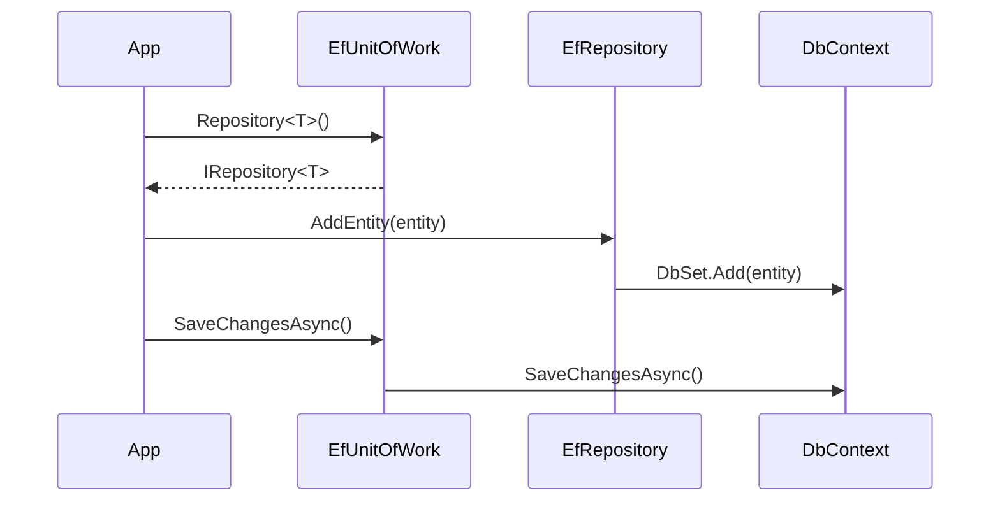

<!-- Mantenido por agentes según AGENTS.md. Puede regenerarse por completo con el prompt de Wiki. -->

# KUtilitiesCore.DataAccess.EfCore

> Implementación de las abstracciones de `KUtilitiesCore.DataAccess` sobre Entity Framework Core: Unit of Work, repositorio genérico y evaluador de especificaciones.
> Punto de entrada: `AddKUtilitiesEfCore<TContext>()` para el registro en DI y `EfUnitOfWork` / `EfRepository<T>` para uso directo.

## 1. Descripción general y propósito

- Namespace raíz: `KUtilitiesCore.DataAccess.EfCore`. Namespaces públicos: `.Evaluators`, `.Extensions`, `.Repositories`, `.UOW`.
- Rol: traduce un `ISpecification<T>` (criterio, includes, orden, paginación, `AsNoTracking`) a una consulta `IQueryable<T>` de EF Core y expone la persistencia como `IUnitOfWork` / `IRepository<T>` ([KUtilitiesCore.DataAccess](KUtilitiesCore.DataAccess.md)).
- Es una de las tres implementaciones del contrato, junto con [KUtilitiesCore.Dal](KUtilitiesCore.Dal.md) y [KUtilitiesCore.DataAccess.Http](KUtilitiesCore.DataAccess.Http.md).
- Estructura: `Evaluators/SpecificationEvaluator.cs`, `Extensions/ServiceCollectionExtensions.cs`, `Repositories/EfRepositoryReadOnly.cs` (contiene `EfRepository<T>` y `EfRepositoryReadOnly<T>`), `UOW/EfUnitOfWork.cs`. El archivo `Guía de Uso.tx.md` es documentación auxiliar del proyecto y no forma parte del API.

## 2. Guía de inicio rápido

### Ejemplo 1: registro en DI

```csharp
using KUtilitiesCore.DataAccess.EfCore.Extensions;
using KUtilitiesCore.DataAccess.UOW.Interfaces;
using Microsoft.EntityFrameworkCore;
using Microsoft.Extensions.DependencyInjection;

public class Cliente
{
    public int Id { get; set; }
    public string? Nombre { get; set; }
}

public class AppDb : DbContext
{
    public AppDb(DbContextOptions<AppDb> options) : base(options) { }
    public DbSet<Cliente> Clientes => Set<Cliente>();
}

public static class Ejemplo1
{
    public static ServiceProvider Configurar()
    {
        var services = new ServiceCollection();
        services.AddDbContext<AppDb>(o => { /* configurar aquí el proveedor de base de datos */ });
        services.AddKUtilitiesEfCore<AppDb>();
        return services.BuildServiceProvider();
    }
}
```

### Ejemplo 2: especificación y lectura

```csharp
using KUtilitiesCore.DataAccess.UOW.Interfaces;
using KUtilitiesCore.DataAccess.UOW.Specifications;

public sealed class ClientesPorPrefijoSpec : BaseSpecification<Cliente>
{
    public ClientesPorPrefijoSpec(string prefijo)
        : base(c => c.Nombre!.StartsWith(prefijo))
    {
        ApplyOrderBy(c => c.Nombre!);
        ApplyNoTracking();
    }
}

public static class Ejemplo2
{
    public static async Task<List<Cliente>> BuscarAsync(IUnitOfWork uow, string prefijo)
    {
        IRepositoryReadOnly<Cliente> repo = uow.Repository<Cliente>();
        var items = await repo.GetEntitiesAsync(new ClientesPorPrefijoSpec(prefijo));
        return items.ToList();
    }
}
```

### Ejemplo 3: escritura con Unit of Work

```csharp
using KUtilitiesCore.DataAccess.UOW.Interfaces;

public static class Ejemplo3
{
    public static async Task<int> AltaAsync(IUnitOfWork uow, string nombre)
    {
        uow.Repository<Cliente>().AddEntity(new Cliente { Nombre = nombre });
        return await uow.SaveChangesAsync();
    }
}
```

### Ejemplo 4: uso directo del evaluador

```csharp
using KUtilitiesCore.DataAccess.EfCore.Evaluators;
using Microsoft.EntityFrameworkCore;

public static class Ejemplo4
{
    public static IQueryable<Cliente> Construir(AppDb db, string prefijo) =>
        SpecificationEvaluator<Cliente>.GetQuery(db.Clientes, new ClientesPorPrefijoSpec(prefijo));
}
```

### Flujo




## 3. Referencia del API principal

### `KUtilitiesCore.DataAccess.EfCore.Evaluators`

| Tipo | Firma |
|---|---|
| `SpecificationEvaluator<T>` (`T : class`) | `public static IQueryable<T> GetQuery(IQueryable<T> inputQuery, ISpecification<T> specification)` |

Orden de aplicación (fuente: `Evaluators/SpecificationEvaluator.cs`): `AsNoTracking` si `IsAsNoTracking` → `Where(Criteria)` si no es null → `Includes` → `IncludeStrings` → `OrderBy` (si no existe, `OrderByDescending`) → `Skip`/`Take` solo si `SkipPagination` es `true`, con `skip = (PageNumber - 1) * PageSize`.

### `KUtilitiesCore.DataAccess.EfCore.Extensions`

| Tipo | Firma |
|---|---|
| `ServiceCollectionExtensions` | `public static IServiceCollection AddKUtilitiesEfCore<TContext>(this IServiceCollection services) where TContext : DbContext` |

Registros (todos `Scoped`): `DbContext` como alias de `TContext`; `IUnitOfWork` → `EfUnitOfWork`; `IRepository<>` → `EfRepository<>`. `TContext` debe estar registrado previamente (por ejemplo con `AddDbContext`).

### `KUtilitiesCore.DataAccess.EfCore.Repositories`

| Tipo | Miembros |
|---|---|
| `EfRepositoryReadOnly<T> : IRepositoryReadOnly<T>` (`T : class`) | `EfRepositoryReadOnly(DbContext dbContext)`; campos protegidos `_dbContext`, `_dbSet`; `int Count(ISpecification<T>)`, `Task<int> CountAsync(ISpecification<T>)`, `IEnumerable<T> GetEntities(ISpecification<T>)`, `Task<IEnumerable<T>> GetEntitiesAsync(ISpecification<T>)`, `T? GetFirstOrDefault(ISpecification<T>)`, `Task<T> GetFirstOrDefaultAsync(ISpecification<T>)` |
| `EfRepository<T> : EfRepositoryReadOnly<T>, IRepository<T>` | `EfRepository(DbContext dbContext)`; `void AddEntity(T)`, `void DeleteEntity(T)`, `void UpdateEntity(T)` |

`AddEntity` usa `DbSet.Add`, `DeleteEntity` usa `DbSet.Remove` y `UpdateEntity` marca la entidad como `EntityState.Modified`. `ApplySpecification` es `internal`. `Count`/`CountAsync` aplican la misma consulta del evaluador, incluida la paginación cuando corresponde.

### `KUtilitiesCore.DataAccess.EfCore.UOW`

| Tipo | Miembros |
|---|---|
| `EfUnitOfWork : IUnitOfWork` | `EfUnitOfWork(DbContext context)`; `IRepository<T> Repository<T>() where T : class`; `int SaveChanges()`; `Task<int> SaveChangesAsync()`; `void Dispose()`; `protected virtual void Dispose(bool disposing)` |

`Repository<T>()` crea `EfRepository<T>` mediante `Activator.CreateInstance` y lo guarda en caché por `typeof(T).Name`. `Dispose` libera el `DbContext` recibido. `IRepositoryProvider.RawRepository<TRepo>()` está implementado de forma explícita y lanza `NotImplementedException`.

## 4. Dependencias y paquetes

| Paquete | Versión |
|---|---|
| `Microsoft.EntityFrameworkCore` | 10.0.12 |
| `Microsoft.Extensions.DependencyInjection.Abstractions` | 10.0.12 |

| Referencia de proyecto | Wiki |
|---|---|
| `KUtilitiesCore.DataAccess/KUtilitiesCore.DataAccess.csproj` | [KUtilitiesCore.DataAccess](KUtilitiesCore.DataAccess.md) |

Acoplamientos notables: `ISpecification<T>`, `IUnitOfWork`, `IRepository<T>` e `IRepositoryReadOnly<T>` provienen de DataAccess (`netstandard2.1`, Nullable disabled); este proyecto es `net10.0` con Nullable enable, por lo que los contratos se consumen sin anotaciones de nulabilidad.

## 5. Reglas de arquitectura y restricciones

| Regla | Evidencia |
|---|---|
| Un único `DbContext` por scope: el alias `DbContext` resuelve a `TContext` | `Extensions/ServiceCollectionExtensions.cs` (comentario "un contexto principal por Scope") |
| Las entidades deben ser `class` | `UOW/EfUnitOfWork.cs`, `Repositories/EfRepositoryReadOnly.cs` |
| La paginación se aplica solo cuando `SkipPagination == true` | `Evaluators/SpecificationEvaluator.cs` |
| `EfUnitOfWork.Dispose` dispone el `DbContext` | `UOW/EfUnitOfWork.cs` |
| No hay API de transacciones explícitas en `EfUnitOfWork` | `UOW/EfUnitOfWork.cs` |

### Qué NO hacer

- No invocar `RawRepository<TRepo>()` a través de `IRepositoryProvider`: lanza `NotImplementedException`.
- No asumir que `SkipPagination = true` omite la paginación aquí: en este evaluador la activa. En `PagingOptions` (DataAccess) el nombre y su comentario ("omitir la paginación") indican lo contrario, y el setter de `PageSize` fija -1 en ese caso; No determinado si la inversión es intencional.
- No usar el mismo `DbContext` tras disponer el `EfUnitOfWork`.
- No registrar `AddKUtilitiesEfCore<TContext>` sin registrar antes `TContext`.

### Puntos de extensión

- Heredar `EfRepository<T>` o `EfRepositoryReadOnly<T>` (campos `_dbContext` y `_dbSet` protegidos) para repositorios específicos.
- Heredar `EfUnitOfWork` (el `Dispose(bool)` es `protected virtual`).
- Crear especificaciones derivando de `BaseSpecification<T>` (ver [KUtilitiesCore.DataAccess](KUtilitiesCore.DataAccess.md)).
