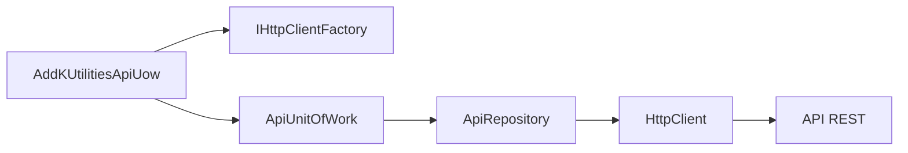
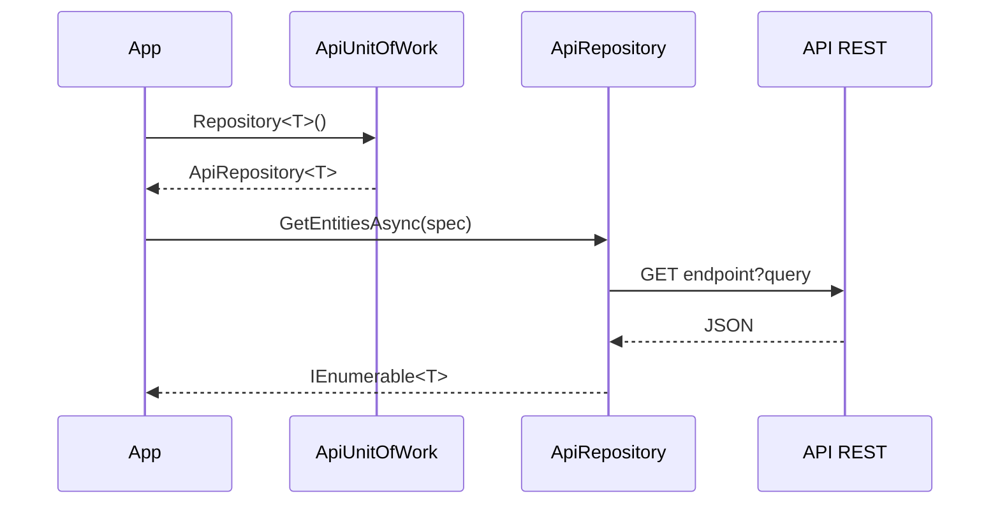

<!-- Mantenido por agentes según AGENTS.md. Puede regenerarse por completo con el prompt de Wiki. -->

# KUtilitiesCore.DataAccess.Http

> Implementación de las abstracciones de `KUtilitiesCore.DataAccess` sobre una API REST con `HttpClient` y JSON: repositorio genérico, Unit of Work sin estado y registro en DI con `IHttpClientFactory`.
> Punto de entrada: `AddKUtilitiesApiUow(clientName, clientConfig)`.

## 1. Descripción general y propósito

- Namespace raíz: `KUtilitiesCore.DataAccess.Http`. Namespaces públicos: `.Extensions`, `.Repositories`, `.UOW`.
- Rol: traduce las operaciones de `IRepository<T>` a llamadas HTTP (`GET`, `POST`, `PUT`, `DELETE`) y las especificaciones a query strings. Es una de las tres implementaciones del contrato, junto con [KUtilitiesCore.Dal](KUtilitiesCore.Dal.md) y [KUtilitiesCore.DataAccess.EfCore](KUtilitiesCore.DataAccess.EfCore.md).
- El Unit of Work es sin estado: cada `AddEntity`/`UpdateEntity`/`DeleteEntity` se ejecuta de inmediato; `SaveChanges` solo devuelve 1.
- Este proyecto no tiene `ImplicitUsings` (`disable`) ni nulabilidad (`Nullable disable`); los ejemplos deben incluir sus `using`.

## 2. Guía de inicio rápido

### Ejemplo 1: registro en DI

```csharp
using System;
using KUtilitiesCore.DataAccess.Http.Extensions;
using Microsoft.Extensions.DependencyInjection;

public static class Ejemplo1
{
    public static ServiceProvider Configurar()
    {
        var services = new ServiceCollection();
        services.AddKUtilitiesApiUow("MiApi", builder =>
        {
            builder.ConfigureHttpClient(c => c.BaseAddress = new Uri("https://api.example.test/"));
        });
        return services.BuildServiceProvider();
    }
}
```

### Ejemplo 2: lectura con especificación

```csharp
using System.Collections.Generic;
using System.Threading.Tasks;
using KUtilitiesCore.DataAccess.UOW.Interfaces;
using KUtilitiesCore.DataAccess.UOW.Specifications;

public class Producto
{
    public int Id { get; set; }
    public string Nombre { get; set; }
}

public sealed class ProductoPorIdSpec : BaseSpecification<Producto>
{
    public ProductoPorIdSpec(int id) { AddParameter("Id", id); }
}

public sealed class ProductosPorCategoriaSpec : BaseSpecification<Producto>
{
    public ProductosPorCategoriaSpec(string categoria) { AddParameter("categoria", categoria); }
}

public static class Ejemplo2
{
    // GET productos/5
    public static Task<Producto> UnoAsync(IUnitOfWork uow, int id) =>
        uow.Repository<Producto>().GetFirstOrDefaultAsync(new ProductoPorIdSpec(id));

    // GET productos?categoria=...
    public static Task<IEnumerable<Producto>> ListarAsync(IUnitOfWork uow, string categoria) =>
        uow.Repository<Producto>().GetEntitiesAsync(new ProductosPorCategoriaSpec(categoria));
}
```

### Ejemplo 3: escritura

```csharp
using System.Threading.Tasks;
using KUtilitiesCore.DataAccess.UOW.Interfaces;

public static class Ejemplo3
{
    public static async Task<int> AltaAsync(IUnitOfWork uow, Producto p)
    {
        uow.Repository<Producto>().AddEntity(p);   // POST productos
        return await uow.SaveChangesAsync();       // devuelve 1; no ejecuta nada adicional
    }
}
```

### Ejemplo 4: convención de endpoint y clave personalizadas

```csharp
using System.Net.Http;
using KUtilitiesCore.DataAccess.Http.Repositories;

public static class Ejemplo4
{
    public static ApiRepositoryReadonly<Producto> Crear(HttpClient client)
    {
        var repo = new ApiRepositoryReadonly<Producto>(client, t => $"api/v1/{t.Name.ToLower()}");
        repo.SetKeySelector(p => p.Id);
        return repo;
    }
}
```

### Flujo





## 3. Referencia del API principal

### `KUtilitiesCore.DataAccess.Http.Extensions`

| Tipo | Firma |
|---|---|
| `ServiceCollectionExtensions` | `public static IServiceCollection AddKUtilitiesApiUow(this IServiceCollection services, string clientName, Action<IHttpClientBuilder> clientConfig)` |

Registra el `HttpClient` con nombre (`services.AddHttpClient(clientName)`, luego invoca `clientConfig`), `IUnitOfWork` como `Scoped` (crea `ApiUnitOfWork(factory, clientName)`) e `IRepository<>` → `ApiRepository<>` como `Scoped`. Según el comentario del código, puede chocar con `AddKUtilitiesEfCore` en el mismo contenedor.

### `KUtilitiesCore.DataAccess.Http.Repositories`

| Tipo | Miembros |
|---|---|
| `ApiRepositoryReadonly<T> : IRepositoryReadOnly<T>` (`T : class`) | `ApiRepositoryReadonly(HttpClient httpClient, Func<Type, string> endpointNamingStrategy = null)`; campos protegidos `_baseEndpoint`, `_httpClient`, `_keySelector`; `SetKeySelector(Func<T, object>)`; virtuales `Count`, `CountAsync`, `GetEntities`, `GetEntitiesAsync`, `GetFirstOrDefault`, `GetFirstOrDefaultAsync`, `AddQueryString(string, ISpecification<T>)` (protegido), `GetIdFromEntity(T)` (protegido) |
| `ApiRepository<T> : ApiRepositoryReadonly<T>, IRepository<T>` | `ApiRepository(HttpClient httpClient)`; virtuales `AddEntity`, `DeleteEntity`, `UpdateEntity` |

Mapeo HTTP (fuente: `Repositories/ApiRepository.cs`):

| Operación | Petición |
|---|---|
| `GetEntities(Async)` | `GET {endpoint}` + query string de `spec.Parameters` |
| `GetFirstOrDefault(Async)` | `GET {endpoint}/single`, o `GET {endpoint}/{Id}` si `spec.Parameters` contiene la clave `"Id"`; el resto de parámetros va como query string |
| `Count(Async)` | `GET {endpoint}/count` + query string |
| `AddEntity` | `POST {endpoint}` con el cuerpo JSON |
| `UpdateEntity` | `PUT {endpoint}` con el cuerpo JSON (sin id en la ruta) |
| `DeleteEntity` | `DELETE {endpoint}/{id}` |

Endpoint por defecto: `typeof(T).Name.ToLower() + "s"`. Clave de entidad para borrar: selector manual → propiedad con `[Key]` → propiedad `Id` (sin distinguir mayúsculas); si no hay ninguna lanza `InvalidOperationException`. Las operaciones de escritura y las variantes síncronas bloquean con `GetAwaiter().GetResult()`. Las escrituras llaman a `EnsureSuccessStatusCode()`.

### `KUtilitiesCore.DataAccess.Http.UOW`

| Tipo | Miembros |
|---|---|
| `ApiUnitOfWork : IUnitOfWork` | `ApiUnitOfWork(IHttpClientFactory httpClientFactory, string clientName = "DefaultApi")`; `Repository<T>() where T : class`; `RawRepository<TRepo>() where TRepo : IRawRepository`; `RegisterCustomRepository<TInterface>() where TInterface : IRawRepository`; `RegisterCustomRepository<TEntity, TRepository>() where TEntity : class where TRepository : IRepository<TEntity>`; `SaveChanges()` y `SaveChangesAsync()` (siempre 1); `Dispose()`; `protected virtual Dispose(bool)` |

Los repositorios personalizados deben exponer un constructor público `(HttpClient)`; `RegisterCustomRepository` lanza `ArgumentException` si no existe. `RawRepository<TRepo>` lanza `UnregisteredRepositoryException` (namespace `KUtilitiesCore.Dal.UOW`, definido en DataAccess) si el tipo no está registrado.

## 4. Dependencias y paquetes

| Paquete | Versión | Uso verificado |
|---|---|---|
| `Microsoft.Extensions.Http` | 10.0.12 | `AddHttpClient`, `IHttpClientFactory` |
| `Microsoft.Extensions.Http.Polly` | 10.0.12 | Sin uso en el código fuente (No determinado su propósito más allá del comentario del csproj: "Políticas de Resiliencia") |
| `Microsoft.AspNetCore.WebUtilities` | 10.0.12 | `QueryHelpers.AddQueryString` |

| Referencia de proyecto | Wiki |
|---|---|
| `KUtilitiesCore.DataAccess/KUtilitiesCore.DataAccess.csproj` | [KUtilitiesCore.DataAccess](KUtilitiesCore.DataAccess.md) |

## 5. Reglas de arquitectura y restricciones

| Regla | Evidencia |
|---|---|
| El UoW es sin estado: `SaveChanges*` no confirma nada, devuelve 1 | `UOW/ApiUnitOfWork.cs` |
| Los repositorios personalizados requieren constructor público `(HttpClient)` | `UOW/ApiUnitOfWork.cs` |
| `HttpClient` se obtiene de `IHttpClientFactory` por nombre | `UOW/ApiUnitOfWork.cs`, `Extensions/ServiceCollectionExtensions.cs` |
| La clave `"Id"` de `spec.Parameters` se usa como segmento de ruta y no como query | `Repositories/ApiRepository.cs` |
| `ImplicitUsings` y `Nullable` deshabilitados | `KUtilitiesCore.DataAccess.Http.csproj` |

### Qué NO hacer

- No esperar atomicidad ni rollback entre varias operaciones: cada una es una petición HTTP independiente.
- No usar `RegisterCustomRepository<TEntity, TRepository>()` esperando que `Repository<TEntity>()` devuelva ese repositorio: el diccionario se indexa por el tipo del repositorio (`_customRepositories[repoType]`), mientras `Repository<T>()` consulta `typeof(T)`; por lo que el repositorio genérico `ApiRepository<T>` es el que se usa. Solo `RawRepository<TRepo>()` consulta por el tipo registrado.
- No combinar `AddKUtilitiesApiUow` y `AddKUtilitiesEfCore` en el mismo contenedor sin resolvedores delegados (aviso del propio código).
- No bloquear el hilo de UI con las variantes síncronas: usan `GetAwaiter().GetResult()`.

### Puntos de extensión

- Heredar `ApiRepository<T>` / `ApiRepositoryReadonly<T>` y sobrescribir `AddQueryString` o `GetIdFromEntity`.
- Inyectar `endpointNamingStrategy` en `ApiRepositoryReadonly<T>` (`ApiRepository<T>` no la expone en su constructor).
- Configurar cabeceras, `BaseAddress` y handlers con el callback `clientConfig` de `AddKUtilitiesApiUow`.
