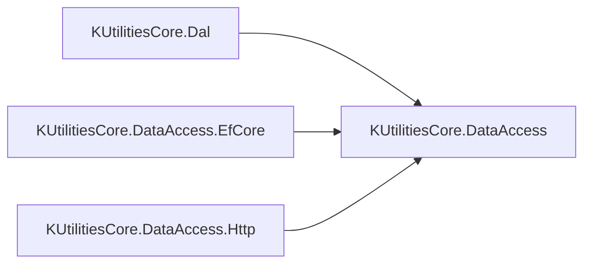

<!-- Mantenido por agentes según AGENTS.md. Puede regenerarse por completo con el prompt de Wiki. -->

# KUtilitiesCore.DataAccess

> Capa de abstracciones de persistencia: Unit of Work, repositorios, patrón Specification y paginación (offset y keyset). No contiene acceso a datos.
> Lo implementan `KUtilitiesCore.Dal` (SQL Server), `KUtilitiesCore.DataAccess.EfCore` y `KUtilitiesCore.DataAccess.Http`. Puntos de entrada: `IUnitOfWork` y `BaseSpecification<T>`.

## 1. Descripción general y propósito

- Namespace raíz: `KUtilitiesCore.DataAccess`. Namespaces públicos: `.Extensions`, `.Paging`, `.UOW.Interfaces`, `.UOW.Specifications`, y `KUtilitiesCore.Dal.UOW` (excepción).
- Rol: contrato común que desacopla el consumo de datos de su implementación. Referenciado por [KUtilitiesCore.Dal](KUtilitiesCore.Dal.md), [KUtilitiesCore.DataAccess.EfCore](KUtilitiesCore.DataAccess.EfCore.md) y [KUtilitiesCore.DataAccess.Http](KUtilitiesCore.DataAccess.Http.md).
- Patrones evidenciados:

| Patrón | Ejemplo |
|---|---|
| Unit of Work | `UOW/Interfaces/IUnitOfWork.cs` |
| Repository (solo lectura y escritura) | `UOW/Interfaces/IRepository.cs` |
| Specification (con paginación incorporada) | `UOW/Specifications/BaseSpecification.cs` |
| Provider de repositorios | `UOW/Interfaces/IRepositoryProvider.cs` |
| Paginación offset y keyset | `Paging/PagingOptions.cs`, `Paging/PagedResult.cs` |

```text
KUtilitiesCore.DataAccess/
├── Extensions/   RepositoryExtensions (GetById, GetByIdAsync)
├── Paging/       IPagingOptions, PagingOptions, IPagedResult, PagedResult, PagingStrategy
└── UOW/          Interfaces/ (contratos), Specifications/ (BaseSpecification), UnregisteredRepositoryException
```

## 2. Guía de inicio rápido

Sin registro DI ni claves de configuración: el proyecto solo define contratos. El registro lo aporta la implementación elegida.

**Definir una especificación paginada y consultar por Unit of Work:**

```csharp
using System.Collections.Generic;
using System.Threading.Tasks;
using KUtilitiesCore.DataAccess.UOW.Interfaces;
using KUtilitiesCore.DataAccess.UOW.Specifications;

public sealed class Cliente
{
    public int Id { get; set; }
    public string Nombre { get; set; }
    public bool Activo { get; set; }
}

public sealed class ClientesActivosSpec : BaseSpecification<Cliente>
{
    public ClientesActivosSpec(int pagina, int tamano) : base(c => c.Activo)
    {
        ApplyOrderBy(c => c.Nombre);
        ApplyNoTracking();
        PageNumber = pagina;
        PageSize = tamano;
    }
}

public static class EjemploConsulta
{
    public static async Task<IEnumerable<Cliente>> ListarAsync(IUnitOfWork uow)
    {
        IRepository<Cliente> repo = uow.Repository<Cliente>();
        return await repo.GetEntitiesAsync(new ClientesActivosSpec(1, 20));
    }
}
```

**Buscar por identificador y guardar cambios:**

```csharp
using KUtilitiesCore.DataAccess.Extensions;
using KUtilitiesCore.DataAccess.UOW.Interfaces;

public static class EjemploGuardado
{
    public static int Renombrar(IUnitOfWork uow, int id, string nombre)
    {
        IRepository<Cliente> repo = uow.Repository<Cliente>();
        Cliente cliente = repo.GetById(c => c.Id == id);
        cliente.Nombre = nombre;
        repo.UpdateEntity(cliente);
        return uow.SaveChanges();
    }
}
```

(`Cliente` es el tipo del ejemplo anterior.)

**Construir un resultado paginado:**

```csharp
using System.Collections.Generic;
using KUtilitiesCore.DataAccess.Paging;

public static class EjemploPaginado
{
    public static PagedResult<Cliente> Crear(IReadOnlyList<Cliente> items, int total) =>
        new PagedResult<Cliente>(items, total, pageNumber: 1, pageSize: 20);
}
```



## 3. Referencia del API principal

Sin miembros `[Obsolete]` ni `[Experimental]`.

### `KUtilitiesCore.DataAccess.UOW.Interfaces`

| Tipo | Clase | Propósito |
|---|---|---|
| `IUnitOfWork` | interface (`IDisposable`) | Unidad de trabajo: `SaveChanges`, `SaveChangesAsync` |
| `IRepositoryProvider` | interface | `Repository<T>()` y `RawRepository<TRepo>()` |
| `IRepositoryReadOnly<T>` | interface | Lectura por especificación |
| `IRepository<T>` | interface | Lectura más `AddEntity`, `UpdateEntity`, `DeleteEntity` |
| `IRawRepository` | interface | Marcador para repositorios no basados en entidad |
| `ISpecification<T>` / `ISpecificationBase` | interface | Criterio, includes, orden, `Parameters` y opciones de paginación |

### Otros namespaces

| Tipo | Clase | Propósito |
|---|---|---|
| `BaseSpecification` / `BaseSpecification<T>` (`.UOW.Specifications`) | abstract class | Base de especificaciones; hereda `PagingOptions` |
| `EntityByIdSpecification<T>` (`.UOW.Specifications`) | class | Especificación por predicado de identificador |
| `RepositoryExtensions` (`.Extensions`) | static class | `GetById`, `GetByIdAsync` |
| `IPagingOptions`, `PagingOptions`, `PagingStrategy` (`.Paging`) | interface / class / enum | Opciones de paginación (`Offset`, `Keyset`) |
| `IPagedResult`, `IPagedResult<out T>`, `PagedResult`, `PagedResult<T>` (`.Paging`) | interface / class | Resultado paginado |
| `UnregisteredRepositoryException` (`KUtilitiesCore.Dal.UOW`) | class | Repositorio no registrado |

```csharp
public interface IUnitOfWork : IRepositoryProvider, IDisposable
{
    Task<int> SaveChangesAsync();
    int SaveChanges();
}

public interface IRepositoryProvider
{
    IRepository<T> Repository<T>() where T : class;
    TRepo RawRepository<TRepo>() where TRepo : IRawRepository;
}

public interface IRepositoryReadOnly<T> where T : class
{
    [return: MaybeNull] T GetFirstOrDefault(ISpecification<T> spec);
    [return: MaybeNull] Task<T> GetFirstOrDefaultAsync(ISpecification<T> spec);
    IEnumerable<T> GetEntities(ISpecification<T> spec);
    Task<IEnumerable<T>> GetEntitiesAsync(ISpecification<T> spec);
    int Count(ISpecification<T> spec);
    Task<int> CountAsync(ISpecification<T> spec);
}

public interface IRepository<T> : IRepositoryReadOnly<T> where T : class
{
    void AddEntity(T entity);
    void UpdateEntity(T entity);
    void DeleteEntity(T entity);
}

public interface ISpecification<T> : ISpecificationBase
{
    Expression<Func<T, bool>> Criteria { get; }
    List<Expression<Func<T, object>>> Includes { get; }
    List<string> IncludeStrings { get; }
    Expression<Func<T, object>> OrderBy { get; }
    Expression<Func<T, object>> OrderByDescending { get; }
    bool IsAsNoTracking { get; }
}
public interface ISpecificationBase : IPagingOptions { IDictionary<string, object> Parameters { get; } }

public interface IPagingOptions
{
    object AfterValue { get; }
    int PageNumber { get; }
    int PageSize { get; }
    bool SkipPagination { get; }
    PagingStrategy Strategy { get; }
}

public abstract class BaseSpecification<T> : BaseSpecification, ISpecification<T>
{
    protected BaseSpecification();
    protected BaseSpecification(Expression<Func<T, bool>> criteria);
    protected virtual void AddParameter(string name, object value);
    protected virtual void AddInclude(string includeString);
    protected virtual void ApplyOrderBy(Expression<Func<T, object>> orderByExpression);
    protected virtual void ApplyOrderByDescending(Expression<Func<T, object>> orderByDescendingExpression);
    protected virtual void ApplyNoTracking();
}

public class PagingOptions : IPagingOptions
{
    public PagingOptions();
    public PagingOptions(int pageNumber, int pageSize, bool skipPagination = false);   // Offset
    public PagingOptions(int pageSize, object afterValue, bool skipPagination = false); // Keyset
}

public class PagedResult<TEntity> : PagedResult, IPagedResult<TEntity>
{
    public PagedResult(IReadOnlyList<TEntity> items, int totalCount, int pageNumber, int pageSize,
        object lastKeyValue = null, bool? hasNextPageOverride = null);
    public IReadOnlyList<TEntity> Items { get; }
}

public static class RepositoryExtensions
{
    public static T GetById<T>(this IRepository<T> repository, Expression<Func<T, bool>> idPredicate) where T : class;
    public static Task<T> GetByIdAsync<T>(this IRepository<T> repository, Expression<Func<T, bool>> idPredicate) where T : class;
}
```

## 4. Dependencias y paquetes

| Paquete | Versión | Uso en este proyecto |
|---|---|---|
| (ninguno) | — | Sin `PackageReference` |

- Referencias a proyectos: ninguna. `FrameworkReference`: ninguna. Analizadores: ninguno configurado. Sin Central Package Management.
- Sin acoplamiento a EF Core ni a SQL Server, aunque `ISpecification<T>` expone conceptos de ORM (`Includes`, `IsAsNoTracking`).

## 5. Reglas de arquitectura y restricciones

| Regla | Evidencia |
|---|---|
| `TargetFramework` = `netstandard2.1`, `Nullable` = `disable`, `ImplicitUsings` = `enable`, `LangVersion` = `latest` | `KUtilitiesCore.DataAccess/KUtilitiesCore.DataAccess.csproj` |
| Contratos "oblivious" (sin anotaciones de nulabilidad) | `KUtilitiesCore.DataAccess.csproj`, `AGENTS.md` |
| Repositorios restringidos a `where T : class` | `UOW/Interfaces/IRepository.cs`, `IRepositoryProvider.cs` |
| Asincronía por `Task`/`Task<T>` sin `CancellationToken` | `UOW/Interfaces/IRepository.cs`, `IUnitOfWork.cs` |
| `GetFirstOrDefault*` marcado con `[return: MaybeNull]` | `UOW/Interfaces/IRepository.cs` |
| La paginación forma parte de la especificación (`ISpecificationBase : IPagingOptions`) | `UOW/Interfaces/ISpecification.cs`, `UOW/Specifications/BaseSpecification.cs` |
| `PageSize` se limita a 100 y toma 10 si el valor no es positivo | `Paging/PagingOptions.cs` |
| Los setters de `PagedResult` son `internal`; el estado se fija en el constructor | `Paging/PagedResult.cs` |
| Keyset sin total: `totalCount = -1` hace que `HasNextPage` dependa de `Items.Count == PageSize` | `Paging/PagedResult.cs` |

**Qué NO hacer**

| Prohibición | Evidencia |
|---|---|
| No esperar `PageSize = -1` si `SkipPagination` se asigna después de `PageSize`: el setter de `PageSize` consulta `SkipPagination` en ese instante (el constructor `PagingOptions(int, int, bool)` asigna `PageSize` primero) | `Paging/PagingOptions.cs` |
| No pedir páginas de más de 100 elementos: se recortan a 100 | `Paging/PagingOptions.cs` |
| No poner lógica específica de un proveedor (SQL, EF, HTTP) en este proyecto: debe ir en `Dal`, `EfCore` o `Http` | `AGENTS.md` |
| No asumir que `UnregisteredRepositoryException` vive en el namespace `KUtilitiesCore.DataAccess`: su namespace es `KUtilitiesCore.Dal.UOW` | `UOW/UnregisteredRepositoryException.cs` |
| No activar `Nullable` en este proyecto sin revisar a los implementadores | `KUtilitiesCore.DataAccess.csproj`, `AGENTS.md` |

**Puntos de extensión**

- Implementar `IUnitOfWork`, `IRepository<T>` e `IRepositoryProvider` en un proyecto de proveedor.
- Derivar de `BaseSpecification<T>` y usar sus métodos `protected` (`AddInclude`, `ApplyOrderBy`, `ApplyNoTracking`, `AddParameter`).
- Implementar `IRawRepository` para repositorios que no operan sobre entidades.
- Reutilizar `PagedResult<T>` para devolver páginas desde cualquier proveedor.
