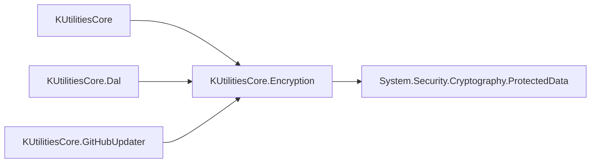
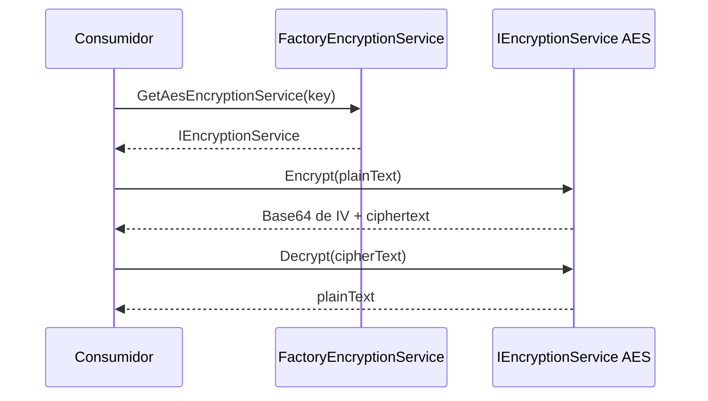

<!-- Mantenido por agentes según AGENTS.md. Puede regenerarse por completo con el prompt de Wiki. -->

# KUtilitiesCore.Encryption

> Servicios de cifrado (AES, Base64, DPAPI condicional) y hash de contraseñas (PBKDF2-SHA256) tras una fábrica estática.
> Lo consumen `KUtilitiesCore`, `KUtilitiesCore.Dal` y `KUtilitiesCore.GitHubUpdater`. Punto de entrada: `FactoryEncryptionService`.

## 1. Descripción general y propósito

- Namespace raíz: `KUtilitiesCore.Encryption`. Otro namespace público: `KUtilitiesCore.Encryption.Extensions`.
- Rol: capa mínima de seguridad que oculta las implementaciones concretas; el consumidor solo ve `IEncryptionService`, `IHashService` y la fábrica.
- Referenciado por: [KUtilitiesCore](KUtilitiesCore.md), [KUtilitiesCore.Dal](KUtilitiesCore.Dal.md), [KUtilitiesCore.GitHubUpdater](KUtilitiesCore.GitHubUpdater.md).
- Patrones evidenciados:
  - Factory estática: `FactoryEncryptionService.cs`.
  - Implementaciones `internal sealed` tras interfaces públicas: `AesEncryptionService.cs`, `Base64EncryptionService.cs`, `HashService.cs`.
  - Compilación condicional por plataforma (DPAPI): `DPAPIEncryptServise.cs`.
- Estructura (el proyecto es casi plano):

```text
KUtiitiesCore.Encryption/   (typo histórico en el nombre de la carpeta: "KUtiities")
├── Extensions/             StringExt: conversión SecureString <-> string
└── *.cs                    interfaces, fábrica, implementaciones internas, SaltGenerator, HashIdentity
```

## 2. Guía de inicio rápido

No requiere registro en DI ni claves de configuración. Se obtiene todo desde la fábrica estática.

Cifrado AES (la clave debe medir 16, 24 o 32 bytes UTF-8):

```csharp
using KUtilitiesCore.Encryption;

public static class EjemploAes
{
    public static string IdaYVuelta(string texto)
    {
        IEncryptionService aes = FactoryEncryptionService.GetAesEncryptionService("Prueba1234567890");
        string cifrado = aes.Encrypt(texto);   // Base64(IV + ciphertext)
        return aes.Decrypt(cifrado);
    }
}
```

Hash de contraseña con sal aleatoria:

```csharp
using KUtilitiesCore.Encryption;

public static class EjemploHash
{
    public static bool Verificar(string clave)
    {
        IHashService hash = FactoryEncryptionService.GetHashServise();
        string almacenado = hash.Hash(clave);
        return hash.IsValid(clave, almacenado);
    }
}
```

`SecureString` a texto cifrado:

```csharp
using System.Security;
using KUtilitiesCore.Encryption;
using KUtilitiesCore.Encryption.Extensions;

public static class EjemploSecureString
{
    public static string Cifrar(string clave)
    {
        SecureString secreto = clave.ToSecureString();
        IEncryptionService servicio = FactoryEncryptionService.GetAesEncryptionService("Prueba1234567890");
        return secreto.ToEncryptedText(servicio);
    }
}
```

Clave derivada del entorno (varía en cada llamada, ver sección 5):

```csharp
using KUtilitiesCore.Encryption;

public static class EjemploIdentidad
{
    public static string Obtener() =>
        HashIdentity.GetUniqueDerivedkey(
            HashIdentity.IdentitySeed.MachineName | HashIdentity.IdentitySeed.UserName);
}
```

Fuente de los ejemplos reales: `KUtilitiesCoreTests/Encryption/AesEncryptionServiceTests.cs`, `KUtilitiesCoreTests/Encryption/HashServiceTests.cs`.





## 3. Referencia del API principal

### Namespace `KUtilitiesCore.Encryption`

| Tipo | Clase de tipo | Propósito |
|---|---|---|
| `FactoryEncryptionService` | static class | Punto único para obtener servicios de hash y cifrado |
| `HashIdentity` | static class | Genera una clave hash a partir de datos del entorno |
| `HashIdentity.IdentitySeed` | enum (`[Flags]`) | Fuentes de entorno: `MachineName = 1`, `UserName = 2` |
| `IEncryptionService` | interface | Contrato `Encrypt` / `Decrypt` sobre `string` |
| `IHashService` | interface | Contrato `Hash` / `IsValid` |
| `SaltGenerator` | static class | Bytes aleatorios criptográficos para sal |

Internos (no consumir): `AesEncryptionService`, `Base64EncryptionService`, `HashService`, `DPAPIEncryptServise` (condicional).

### Namespace `KUtilitiesCore.Encryption.Extensions`

| Tipo | Clase de tipo | Propósito |
|---|---|---|
| `StringExt` | static class | Conversión entre `string`, `SecureString` y texto cifrado |

### Firmas

```csharp
namespace KUtilitiesCore.Encryption
{
    public interface IEncryptionService
    {
        string Encrypt(string plainText);
        string Decrypt(string cipherText);
    }

    public interface IHashService
    {
        string Hash(string plainText);
        bool IsValid(string plainText, string hashedText);
    }

    public static class FactoryEncryptionService
    {
        public static IHashService GetHashServise(bool useSaltHashOrder = true, int maximumSaltLength = 32, int iterations = 10000);
        public static IEncryptionService GetBase64EncryptionService();
        public static IEncryptionService GetAesEncryptionService(string key);
        // Solo si se define el símbolo WINDOWS (ver sección 5):
        // public static IEncryptionService GetDPAPIEncryptionService(DataProtectionScope scope = DataProtectionScope.CurrentUser);
    }

    public static class HashIdentity
    {
        [Flags] public enum IdentitySeed { MachineName = 1, UserName = 2 }
        public static string GetUniqueDerivedkey(IdentitySeed seed);   // ArgumentException si seed == 0
    }

    public static class SaltGenerator
    {
        public static byte[] GetSalt();                       // longitud 32
        public static byte[] GetSalt(int maximumSaltLength);  // array de esa longitud, relleno con RandomNumberGenerator
    }
}

namespace KUtilitiesCore.Encryption.Extensions
{
    public static class StringExt
    {
        public static SecureString ToSecureString(this string plainText);                                   // devuelve SecureString de solo lectura
        public static string ToEncryptedText(this SecureString secure, IEncryptionService encryptionService);
        public static string ToPlainText(this SecureString secure);                                         // expone el secreto en memoria; usar con cuidado
    }
}
```

Comportamiento relevante:

- AES: IV aleatorio por llamada, se antepone al ciphertext y todo se codifica en Base64. `Encrypt`/`Decrypt` lanzan `ArgumentNullException` si el texto es `null` o vacío.
- Hash: PBKDF2 con `HashAlgorithmName.SHA256`, 20 bytes de hash; salida Base64 de `sal + hash` (o `hash + sal` si `useSaltHashOrder` es `false`).
- Los comentarios XML de `AesEncryptionService` dicen "asíncrona", pero los métodos son síncronos.

## 4. Dependencias y paquetes

| Paquete | Versión | Uso en este proyecto |
|---|---|---|
| `System.Security.Cryptography.ProtectedData` | 10.0.12 | `ProtectedData` para DPAPI (código condicional) |

- Versiones tomadas del propio `.csproj`: no existe `Directory.Packages.props` (sin Central Package Management).
- Referencias a proyectos: ninguna.
- `FrameworkReference`: ninguna. Analizadores: ninguno configurado.
- Acoplamiento técnico: DPAPI depende de Windows. Se usa `System.Security.Cryptography` del runtime para AES, PBKDF2 y `RandomNumberGenerator`.

## 5. Reglas de arquitectura y restricciones

| Regla | Evidencia |
|---|---|
| `Nullable` = `enable`, `ImplicitUsings` = `enable`, `LangVersion` = `latest` | `KUtiitiesCore.Encryption/KUtilitiesCore.Encryption.csproj` |
| Implementaciones concretas `internal sealed`; solo interfaces y fábrica son públicas | `AesEncryptionService.cs`, `Base64EncryptionService.cs`, `HashService.cs`, `FactoryEncryptionService.cs` |
| API síncrona: sin `Task`, sin `CancellationToken` | `IEncryptionService.cs`, `IHashService.cs` |
| Validación de argumentos con `ArgumentNullException` / `ArgumentException` | `AesEncryptionService.cs`, `Extensions/StringExt.cs`, `HashIdentity.cs` |
| Aleatoriedad criptográfica con `RandomNumberGenerator` | `SaltGenerator.cs` |
| Hash con `Rfc2898DeriveBytes.Pbkdf2` (SHA256, 20 bytes) | `HashService.cs` |
| Constructor primario en `HashService` (C# 12+) | `HashService.cs` |
| Namespaces con bloque `namespace X { }` (no file-scoped) | todos los `.cs` del proyecto |
| Sin logging ni DI: no hay `ILogger` ni extensiones de `IServiceCollection` | `KUtilitiesCore.Encryption.csproj` (única `PackageReference`: ProtectedData) |
| DPAPI bajo compilación condicional: `#if WINDOWS` (fábrica) y `#if windows` (clase) | `FactoryEncryptionService.cs`, `DPAPIEncryptServise.cs` |
| Documentación XML en español y `GenerateDocumentationFile=True` | `KUtilitiesCore.Encryption.csproj` |

**Qué NO hacer**

| Prohibición | Evidencia |
|---|---|
| No instanciar `AesEncryptionService`, `Base64EncryptionService` ni `HashService` con `new`: son `internal`; usar la fábrica | `FactoryEncryptionService.cs` |
| No usar `GetBase64EncryptionService()` para proteger secretos: solo codifica ("no usar en producción") | `Base64EncryptionService.cs` |
| No pasar claves AES que no midan 16, 24 o 32 **bytes** UTF-8 (lanza `ArgumentException`) | `AesEncryptionService.cs` |
| No pasar `null` ni cadena vacía a `Encrypt`/`Decrypt` de AES | `AesEncryptionService.cs` |
| No usar `HashIdentity.GetUniqueDerivedkey` como clave estable: usa `HashService` con sal aleatoria, cada llamada devuelve un valor distinto | `HashIdentity.cs`, `HashService.cs` |
| No llamar a `GetDPAPIEncryptionService` esperando que exista: ni el `.csproj` define `WINDOWS` ni el TFM es `net10.0-windows`, por lo que el método y la clase `DPAPIEncryptServise` no se compilan. Además la clase usa `#if windows` (minúsculas), distinto de `WINDOWS` | `FactoryEncryptionService.cs`, `DPAPIEncryptServise.cs`, `KUtilitiesCore.Encryption.csproj` |
| No "corregir" los nombres con typos (`GetHashServise`, `DPAPIEncryptServise`, `GetUniqueDerivedkey`, carpeta `KUtiitiesCore.Encryption`): forman parte del API y de las rutas de `ProjectReference` | `FactoryEncryptionService.cs`, `HashIdentity.cs`, `KUtilitiesCore.Dal.csproj` |
| No dejar `ToPlainText` expuesto a registros o variables de larga vida: devuelve el secreto en claro | `Extensions/StringExt.cs` |

**Puntos de extensión**

- Implementar `IEncryptionService` o `IHashService` en el consumidor; son interfaces públicas y `StringExt.ToEncryptedText` acepta cualquier `IEncryptionService`.
- Para ofrecer una implementación nueva desde la fábrica: crear una clase `internal sealed` que implemente la interfaz y añadir un método estático en `FactoryEncryptionService`, sin exponer el tipo concreto.
