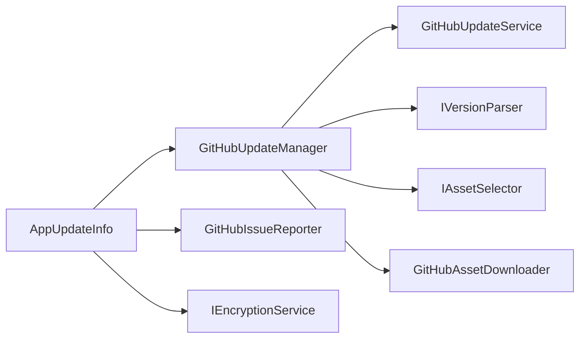
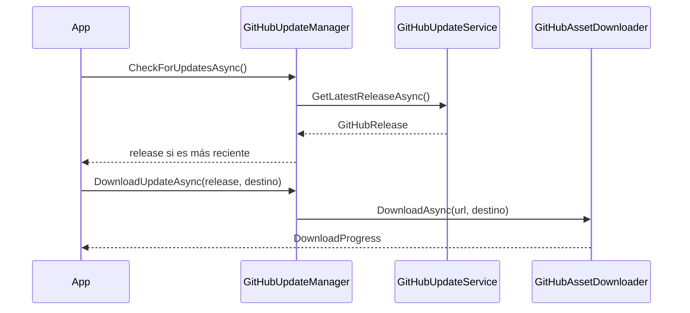

<!-- Mantenido por agentes según AGENTS.md. Puede regenerarse por completo con el prompt de Wiki. -->

# KUtilitiesCore.GitHubUpdater

> Actualización de aplicaciones desde las releases de GitHub (consulta, comparación de versiones, selección de asset y descarga con progreso) y creación de issues desde el cliente, con token almacenado cifrado.
> Puntos de entrada: `AppUpdateInfo`, `GitHubUpdateService`, `GitHubAssetDownloader`, `GitHubUpdateManager` y `GitHubIssueReporter`.

## 1. Descripción general y propósito

- Namespace raíz: `KUtilitiesCore.GitHubUpdater`. Namespaces públicos: `.AssetDownloader`, `.Helpers`, `.Interface`.
- Rol: `GitHubUpdateManager` orquesta `GitHubUpdateService` (obtiene la última release del canal), `IVersionParser` (compara versiones), `IAssetSelector` (elige el asset por patrón) y `GitHubAssetDownloader` (descarga con eventos de progreso). `AppUpdateInfo` persiste la configuración (versión, patrón, canal, repositorio y token cifrado) en un archivo JSON.
- El token de GitHub nunca se expone en texto plano en el API: se asigna con `SetPlaintextToken` y se recupera como `SecureString` con `GetToken()`.
- Los tipos de `Helpers/GitHubRepositoryInfoExt.cs` son `internal`.

## 2. Guía de inicio rápido

### Ejemplo 1: configurar la información de actualización

```csharp
using KUtilitiesCore.GitHubUpdater;

public static class Ejemplo1
{
    public static AppUpdateInfo Configurar(string token)
    {
        var info = new AppUpdateInfo();
        info.AppVersion = "1.0.0";
        info.AssetPattern = "*.zip";
        info.UpdateChannel = "Production";
        info.GitHub.Owner = "mi-organizacion";
        info.GitHub.Repository = "mi-aplicacion";
        info.SetPlaintextToken(token);   // se cifra antes de almacenarse
        info.SaveChanges();
        return info;
    }
}
```

### Ejemplo 2: buscar y descargar una actualización

```csharp
using KUtilitiesCore.GitHubUpdater;
using KUtilitiesCore.GitHubUpdater.AssetDownloader;
using KUtilitiesCore.GitHubUpdater.Helpers;
using KUtilitiesCore.GitHubUpdater.Interface;

public static class Ejemplo2
{
    public static async Task ActualizarAsync(IAppUpdateInfo info, string destino)
    {
        var descargador = new GitHubAssetDownloader(info.GetToken());
        var manager = new GitHubUpdateManager(
            info,
            new GitHubUpdateService(info),
            descargador,
            new DefaultVersionParser(),
            new WildcardAssetSelector());

        manager.DownloadProgress += (_, e) =>
            Console.WriteLine($"{e.Status}: {e.Progress}%");

        GitHubRelease? release = await manager.CheckForUpdatesAsync();
        if (release is not null)
            await manager.DownloadUpdateAsync(release, destino);
    }
}
```

### Ejemplo 3: reportar un issue

```csharp
using KUtilitiesCore.GitHubUpdater;
using KUtilitiesCore.GitHubUpdater.Interface;

public static class Ejemplo3
{
    public static Task ReportarAsync(IAppUpdateInfo info, Exception ex) =>
        new GitHubIssueReporter(info).CreateIssueAsync(
            "Error no controlado en el cliente",
            ex.ToString());
}
```

### Flujo





## 3. Referencia del API principal

### `KUtilitiesCore.GitHubUpdater`

| Tipo | Miembros |
|---|---|
| `AppUpdateInfo : IAppUpdateInfo` (sealed) | Constructor `(Encryption.IEncryptionService? encryptionService = null, string filePath = "")`; `AppVersion`, `AssetPattern`, `UpdateChannel` (`string`, lectura/escritura), `GitHub` (`IGitHubRepositoryInfo`); `GetToken()` (`SecureString`), `SetPlaintextToken(string)`, `SaveChanges()`, `LoadJson(string)` |
| `GitHubRepositoryInfo : IGitHubRepositoryInfo` (sealed) | `Owner`, `Repository`, `API_URL = "https://api.github.com"`, `IssueLabels = ["bug", "reported-from-client"]`, `EncryptedToken` (setter `internal`) |
| `GitHubUpdateService` | `GitHubUpdateService(IAppUpdateInfo info)`; `Task<GitHubRelease?> GetLatestReleaseAsync()` |
| `GitHubUpdateManager : IGitHubUpdateManager` | Constructor `(IAppUpdateInfo, GitHubUpdateService, GitHubAssetDownloader, IVersionParser, IAssetSelector)` (todos obligatorios; lanza `ArgumentNullException`); evento `DownloadProgress`; `Task<GitHubRelease?> CheckForUpdatesAsync()`; `Task DownloadUpdateAsync(GitHubRelease release, string destinationPath, CancellationToken ct = default)` |
| `GitHubIssueReporter` | `GitHubIssueReporter(IAppUpdateInfo info)`; `Task CreateIssueAsync(string title, string body)` |

Si no se indica `filePath`, `AppUpdateInfo` usa el archivo `GitHubRepositoryInfo.json` dentro del directorio temporal del usuario (`Path.GetTempPath()`).

### `KUtilitiesCore.GitHubUpdater.AssetDownloader`

| Tipo | Miembros |
|---|---|
| `GitHubAssetDownloader` | `GitHubAssetDownloader(SecureString githubToken)`; evento `DownloadProgress`; `Task DownloadAsync(string url, string destinationPath, CancellationToken cancellationToken = default)` |
| `DownloadProgressEventArgs : EventArgs` | `Status`, `Progress` (`int`), `Exception`; `static Create(DownloadStatus status, int downloadProgress = 0, Exception? exception = null)` |
| `DownloadStatus` (enum) | `Wait`, `Downloading`, `Downloaded`, `Failed` |

`DownloadAsync` tiene dos implementaciones seleccionadas por directiva `#if NET8_0_OR_GREATER`; con `net10.0` aplica la primera rama.

### `KUtilitiesCore.GitHubUpdater.Helpers`

| Tipo | Miembros |
|---|---|
| `GitHubRelease` | `Id`, `TagName`, `Name`, `Body`, `Draft`, `Prerelease`, `CreatedAt`, `PublishedAt`, `Assets` (`List<GitHubAsset>?`) |
| `GitHubAsset` | `Id`, `Name`, `Label`, `ContentType`, `Size`, `BrowserDownloadUrl` |
| `DefaultVersionParser : IVersionParser` | `Version Parse(string tagName)`, `string GetChannel(string tagName)` |
| `WildcardAssetSelector : IAssetSelector` | `GitHubAsset? Select(IEnumerable<GitHubAsset> assets, string pattern)` |
| Extensiones de serialización (clase estática en `Utilities.cs`) | `ToJson<T>(this T, JsonSerializerOptions? = null)`, `FromJson<T>(this string, JsonSerializerOptions? = null)` y las variantes con `JsonSerializerSettings?` (Newtonsoft) |

### `KUtilitiesCore.GitHubUpdater.Interface`

| Tipo | Miembros |
|---|---|
| `IAppUpdateInfo` | `AppVersion`, `AssetPattern`, `UpdateChannel`, `GitHub`, `GetToken()`, `LoadJson(string)`, `SaveChanges()`, `SetPlaintextToken(string)` |
| `IGitHubRepositoryInfo` | `API_URL`, `EncryptedToken` (solo lectura), `IssueLabels`, `Owner`, `Repository` |
| `IGitHubUpdateManager` | `DownloadProgress`, `CheckForUpdatesAsync()`, `DownloadUpdateAsync(...)` |
| `IVersionParser` | `Parse(string tagName)`, `GetChannel(string tagName)` |
| `IAssetSelector` | `Select(IEnumerable<GitHubAsset>, string pattern)` |

## 4. Dependencias y paquetes

| Paquete | Versión |
|---|---|
| `Newtonsoft.Json` | 13.0.4 |

| Referencia de proyecto | Wiki |
|---|---|
| `KUtiitiesCore.Encryption/KUtilitiesCore.Encryption.csproj` | [KUtilitiesCore.Encryption](KUtilitiesCore.Encryption.md) |

Acoplamientos notables: el cifrado del token usa `IEncryptionService` de Encryption; sin servicio inyectado, `AppUpdateInfo` crea uno AES mediante `FactoryEncryptionService.GetAesEncryptionService` con una clave literal embebida en `AppUpdateInfo.cs` (valor omitido en esta wiki). El archivo `Helpers/Utilities.cs` usa tanto `System.Text.Json` como Newtonsoft.

## 5. Reglas de arquitectura y restricciones

| Regla | Evidencia |
|---|---|
| El token se maneja cifrado y se expone como `SecureString` | `AppUpdateInfo.cs`, `Interface/IAppUpdateInfo.cs` |
| `GitHubUpdateManager` exige todas sus dependencias no nulas | `GitHubUpdateManager.cs` |
| `EncryptedToken` solo puede asignarse dentro del ensamblado | `GitHubRepositoryInfo.cs` (`internal set`) |
| Los eventos de progreso del descargador se reenvían desde el manager | `GitHubUpdateManager.cs` |
| La URL base de la API es configurable (`API_URL`) | `GitHubRepositoryInfo.cs` |

### Qué NO hacer

- No almacenar ni registrar el token en texto plano: usar `SetPlaintextToken` y `GetToken()`.
- No depender de la clave por defecto de `AppUpdateInfo` en producción: inyectar un `IEncryptionService` propio.
- No guardar la configuración en la ubicación temporal por defecto si debe persistir: indicar `filePath`.
- No ejecutar `DownloadUpdateAsync` con una release sin assets que coincidan con `AssetPattern`.

### Puntos de extensión

- Implementar `IVersionParser` para otros esquemas de etiquetas.
- Implementar `IAssetSelector` para otros criterios de selección de asset.
- Implementar `IAppUpdateInfo` para otro almacenamiento de configuración.
- Apuntar `GitHubRepositoryInfo.API_URL` a una instancia de GitHub Enterprise.
