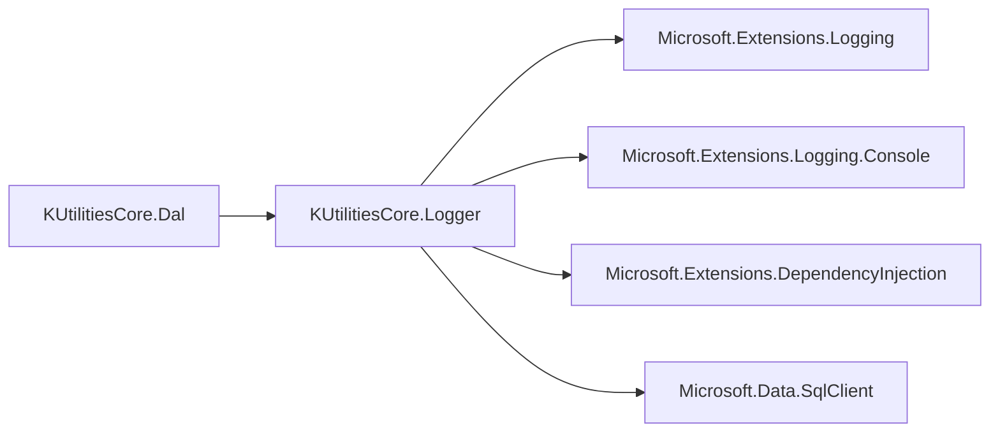
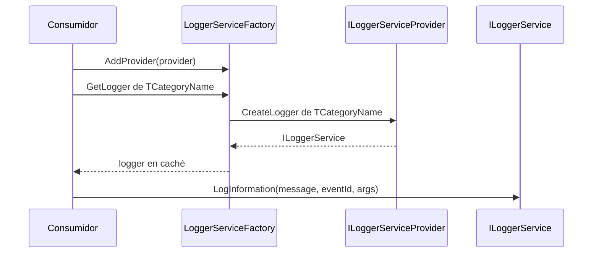

<!-- Mantenido por agentes según AGENTS.md. Puede regenerarse por completo con el prompt de Wiki. -->

# KUtilitiesCore.Logger

> Servicios de logging sobre `Microsoft.Extensions.Logging` con proveedores de archivo (con rotación y cola), SQL Server y ventana de depuración, más logger compuesto y logger nulo.
> Lo consume `KUtilitiesCore.Dal`. Puntos de entrada: `LoggerServiceFactory` y `ILoggerService<T>`.

## 1. Descripción general y propósito

- Namespace raíz: `KUtilitiesCore.Logger`. Otros namespaces públicos: `.Info`, `.Options`, `.Providers` (`.Helpers` es solo `internal`).
- Rol: logging propio de la solución, multi-destino. Referenciado por [KUtilitiesCore.Dal](KUtilitiesCore.Dal.md) (`DaoContext`, `StoreProcedureHelper`).
- Apunta a `netstandard2.0` para poder consumirse desde runtimes .NET anteriores (`README.md` de la raíz).
- Patrones evidenciados:

| Patrón | Ejemplo |
|---|---|
| Abstract factory + proveedores registrables | `LoggerServiceFactory.cs`, `ILoggerServiceProvider.cs`, `Providers/*.cs` |
| Composite | `CompositeLogger.cs` |
| Null Object | `NullLoggerService.cs` |
| Productor-consumidor (cola + tarea de fondo) | `FileLogger.cs` (`BlockingCollection<LogEntry>`) |
| Options | `Options/*.cs` |

```text
KUtilities.Logger/              (la carpeta no lleva "Core" en el nombre)
├── Helpers/    LogEntry, LoggerScope (internal)
├── Info/       ExceptionInfo, CommonExtensions (públicos); CallerInfo (internal)
├── Options/    LoggerOptions, FileLoggerOptions, SqlLoggerOptions
├── Providers/  Debug-, File-, Null- y SqlLoggerServiceProvider
└── *.cs        interfaces, fábrica, CompositeLogger, SqlLogger, NullLoggerService, FileLogger/DebugWindowLogger (internal)
```

## 2. Guía de inicio rápido

No hay extensiones DI ni lectura de configuración: se construye con código.

**Logger de archivo** (cola asíncrona con rotación):

```csharp
using System;
using System.IO;
using KUtilitiesCore.Logger;
using KUtilitiesCore.Logger.Options;
using KUtilitiesCore.Logger.Providers;
using Microsoft.Extensions.Logging;

public sealed class Servicio { }

public static class EjemploLogger
{
    public static void Probar()
    {
        var opciones = new FileLoggerOptions
        {
            LogDirectory = Path.Combine(AppContext.BaseDirectory, "logs"),
            ApplicationName = "MiApp",
            MinimumLogLevel = LogLevel.Information
        };

        using var fabrica = new LoggerServiceFactory();
        fabrica.AddProvider(new FileLoggerServiceProvider(opciones));

        ILoggerService<Servicio> log = fabrica.GetLogger<Servicio>();
        log.LogInformation("Inicio {0}", CommonEventsID.ApplicationStart, 1);
        log.LogError(new InvalidOperationException("fallo"), "Error {0}", CommonEventsID.ApplicationError, "detalle");
    }
}
```

**Logger compuesto** (depuración + SQL Server):

```csharp
using System;
using KUtilitiesCore.Logger;
using KUtilitiesCore.Logger.Options;
using KUtilitiesCore.Logger.Providers;

public sealed class Reporte { }

public static class EjemploCompuesto
{
    public static void Probar(string connectionString)
    {
        using var fabrica = new LoggerServiceFactory();
        fabrica.AddProvider(new DebugLoggerServiceProvider(new LoggerOptions()));
        fabrica.AddProvider(new SqlLoggerServiceProvider(new SqlLoggerOptions
        {
            ConnectionString = connectionString,   // no versionar valores reales
            ApplicationName = "MiApp",
            ResolveUser = () => Environment.UserName
        }));

        ILoggerService<Reporte> log = fabrica.GetLogger<Reporte>(composite: true);
        log.LogWarning("Advertencia {0}", CommonEventsID.Performance, 42);
    }
}
```

Fuente de ejemplos reales: `KUtilitiesCore.LoggerTests/CompositeLoggerTests.cs`, `KUtilitiesCore.LoggerTests/LoggerServiceFactory_DebugLoggerServiceProvider_Tests.cs`.





## 3. Referencia del API principal

Sin miembros `[Obsolete]` ni `[Experimental]`.

### Namespace `KUtilitiesCore.Logger`

| Tipo | Clase | Propósito |
|---|---|---|
| `ILoggerService` / `ILoggerService<out TCategory>` | interface | `ILogger` con sobrecargas `Log*(message, EventId?, params object[])` |
| `ILoggerServiceFactory` | interface (`IDisposable`) | Registro de proveedores y obtención de loggers |
| `ILoggerServiceProvider` | interface | `Name` y `CreateLogger<TCategoryName>()` |
| `ISqlLoggerService<out T>` | interface | Añade `EnsureDatabaseCreated()` |
| `LoggerServiceFactory` | class | Fábrica con caché por proveedor y categoría |
| `CompositeLogger<T>` | class | Reenvía cada entrada a varios loggers |
| `NullLoggerService<T>` | sealed class | Logger que no hace nada; `Instance` |
| `SqlLogger<T>` | class | Escribe en una tabla de SQL Server |
| `LoggerServiceAbstract<TCategoryName,TOptions>` | abstract class | Base interna de los loggers (no extensible fuera, ver sección 5) |
| `CommonEventsID` | static class | `EventId` comunes (`ApplicationStart` 102, `ApplicationError` 101, `DataAccess` 120, `Performance` 160…) |

`FileLogger<T>` y `DebugWindowLogger<T>` son `internal`.

### `KUtilitiesCore.Logger.Options`

| Tipo | Clase | Propósito |
|---|---|---|
| `ILoggerOptions` | interface | `MinimumLogLevel` |
| `LoggerOptions` | class | `MinimumLogLevel = LogLevel.Trace` |
| `FileLoggerOptions` | class | `LogDirectory`, `MaxFileSizeBytes` (10 MB), `MaxRetainedFiles` (5), `RetentionDays` (30), `UseJSonFormat`, `ApplicationName` |
| `SqlLoggerOptions` | class | `ConnectionString`, `TableName` (`ApplicationLogs`), `SchemaName` (`dbo`), `AutoCreateTable` (`true`), `ApplicationName`, `ResolveUser` |

### `KUtilitiesCore.Logger.Providers` e `.Info`

| Tipo | Clase | Propósito |
|---|---|---|
| `DebugLoggerServiceProvider(LoggerOptions)` | class | Crea el logger de ventana de depuración |
| `FileLoggerServiceProvider(FileLoggerOptions)` | class (`IDisposable`) | Crea el logger de archivo |
| `NullLoggerServiceProvider` | class | Crea `NullLoggerService<T>` |
| `SqlLoggerServiceProvider(SqlLoggerOptions)` | class | Crea `SqlLogger<T>` |
| `ExceptionInfo` | class | Extrae y formatea una excepción (`GetReport`, `GetStackTraceBlock`, …) |
| `CommonExtensions` | static class | `GetExceptionHash(this Exception)`, `ToShortString(this Type/MethodInfo)` |

```csharp
public interface ILoggerService : ILogger
{
    void LogInformation(string message, EventId? eventId, params object[] args);
    void LogInformation(Exception exception, string message, EventId? eventId, params object[] args);
    // Idem para LogTrace, LogDebug, LogWarning, LogError y LogCritical
}
public interface ILoggerService<out TCategory> : ILogger<TCategory>, ILoggerService { }

public interface ILoggerServiceProvider
{
    string Name { get; }
    ILoggerService<TCategoryName> CreateLogger<TCategoryName>();
}

public interface ILoggerServiceFactory : IDisposable
{
    void AddProvider(ILoggerServiceProvider provider);
    ILoggerService<TCategoryName> GetLogger<TCategoryName>(string providerName);
    ILoggerService<TCategoryName> GetLogger<TCategoryName>(bool composite = false);
}

public class CompositeLogger<TCategoryName> : ILoggerService<TCategoryName>
{
    public CompositeLogger(IEnumerable<ILoggerService<TCategoryName>> loggers);
}
```

Comportamiento de `GetLogger<T>(bool composite = false)`: sin proveedores devuelve `NullLoggerService<T>.Instance`; con `composite = false` usa el primer proveedor registrado; con `true` combina todos en un `CompositeLogger<T>`. Lanza `ObjectDisposedException` si la fábrica ya fue liberada.

## 4. Dependencias y paquetes

| Paquete | Versión | Uso en este proyecto |
|---|---|---|
| `Microsoft.Extensions.Logging` | 10.0.12 | `ILogger`, `LogLevel`, `EventId` |
| `Microsoft.Extensions.Logging.Console` | 10.0.12 | Referenciado; sin uso detectado en el código fuente |
| `Microsoft.Extensions.DependencyInjection` | 10.0.12 | Referenciado; sin uso detectado en el código fuente |
| `Microsoft.Data.SqlClient` | 7.1.0 | `SqlConnection` en `SqlLogger` |

- Versiones tomadas del `.csproj`: no existe `Directory.Packages.props`.
- Referencias a proyectos: ninguna. `FrameworkReference`: ninguna. Analizadores: ninguno configurado. `ImplicitUsings` no está habilitado.
- Acoplamientos: SQL Server (`SqlLogger`); el `FileLogger` usa un `Mutex` con nombre `Global\FileLoggerMutex`.

## 5. Reglas de arquitectura y restricciones

| Regla | Evidencia |
|---|---|
| `Nullable` = `enable`, `LangVersion` = `latest`, `GenerateDocumentationFile=True` | `KUtilities.Logger/KUtilitiesCore.Logger.csproj` |
| Las interfaces extienden `ILogger`/`ILogger<T>` de Microsoft.Extensions.Logging | `ILoggerService.cs` |
| Los `Log*` propios exigen el parámetro `EventId?` (sin valor por defecto) | `ILoggerService.cs` |
| La fábrica cachea loggers por proveedor y categoría; sin proveedores devuelve el logger nulo | `LoggerServiceFactory.cs` |
| `LoggerServiceFactory.Dispose` libera los loggers en caché (no los proveedores) | `LoggerServiceFactory.cs` |
| `FileLogger` encola entradas en `BlockingCollection` y las procesa en una tarea de fondo; rota por tamaño | `FileLogger.cs` |
| `SqlLogger` crea la tabla si `AutoCreateTable` es `true`; los errores de escritura van a `Debug.WriteLine` y no se propagan | `SqlLogger.cs`, `Options/SqlLoggerOptions.cs` |
| Clase base con constructor primario (`LoggerServiceAbstract(TOptions options)`) | `LoggerServiceAbstract.cs` |
| Sin DI propia: no hay extensiones de `IServiceCollection` ni `ILoggerProvider` | búsqueda en el código fuente del proyecto |

**Qué NO hacer**

| Prohibición | Evidencia |
|---|---|
| No heredar de `LoggerServiceAbstract<,>` fuera del ensamblado: declara `internal abstract void WriteLog(LogEntry)` y `LogEntry` es `internal`. Implementar `ILoggerService<T>` directamente | `LoggerServiceAbstract.cs`, `Helpers/LogEntry.cs`, `KUtilitiesCore.LoggerTests/CompositeLoggerTests.cs` |
| No instanciar `FileLogger<T>` ni `DebugWindowLogger<T>` (son `internal`): usar los proveedores | `FileLogger.cs`, `DebugWindowLogger.cs` |
| No esperar que `FileLoggerServiceProvider` libere los `FileLogger` que crea: liberar la fábrica | `Providers/FileLoggerServiceProvider.cs`, `LoggerServiceFactory.cs` |
| No contar con excepciones para detectar fallos de `SqlLogger` | `SqlLogger.cs` |
| No registrar cadenas de conexión reales en código ni en documentación | `Options/SqlLoggerOptions.cs` |

**Puntos de extensión**

- Implementar `ILoggerServiceProvider` y registrarlo con `LoggerServiceFactory.AddProvider`.
- Implementar `ILoggerService<T>` para destinos nuevos (ver `EnabledMockLogger` en `CompositeLoggerTests.cs`).
- Derivar opciones de `LoggerOptions` para configurar un proveedor nuevo.
- Obtener `NullLoggerService<T>.Instance` como valor por defecto cuando no se quiera registrar nada.
