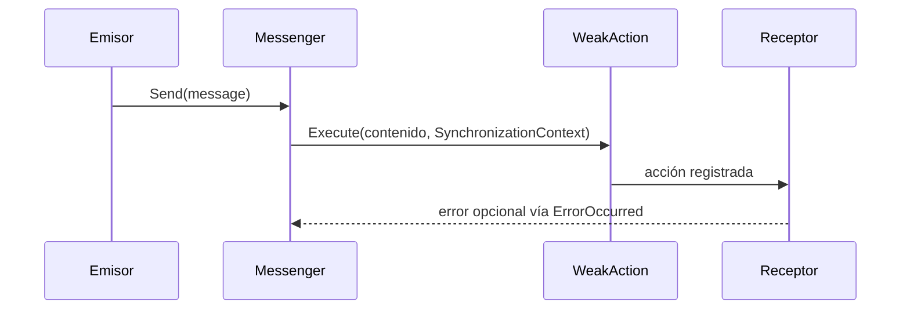

<!-- Mantenido por agentes según AGENTS.md. Puede regenerarse por completo con el prompt de Wiki. -->

# KUtilitiesCore.MVVM.Messaging

> Bus de mensajes en memoria con referencias débiles, tokens y filtro por tipo de destino, para comunicar ViewModels sin acoplarlos.
> Ningún proyecto de producción de la solución lo referencia; solo `KUtilitiesCore.MVVMTests`. Punto de entrada: `Messenger.Default` (`IMessenger`).

## 1. Descripción general y propósito

- Namespace raíz y único: `KUtilitiesCore.MVVM.Messaging`.
- Rol: biblioteca autónoma, sin `ProjectReference` ni paquetes. Referenciada solo por las pruebas [KUtilitiesCore.MVVMTests] (proyecto de pruebas, sin wiki).
- Patrones evidenciados:

| Patrón | Ejemplo |
|---|---|
| Mediator / publicador-suscriptor | `IMessenger.cs`, `Messenger.cs` |
| Singleton reemplazable | `Messenger.Default`, `OverrideDefault`, `Reset` en `Messenger.cs` |
| Referencia débil | `WeakAction.cs` |
| Mensaje condicional | `IConditionalMessage.cs`, `VMMessageBase.cs` |

```text
KUtilitiesCore.MVVM.Messaging/   (todos los archivos en la raíz, sin subcarpetas)
```

## 2. Guía de inicio rápido

Sin DI ni configuración. La entrega es asíncrona (ver sección 5).

**Registrar, enviar y desregistrar** (basado en `KUtilitiesCore.MVVMTests/Messaging/MessengerTests.cs`):

```csharp
using System;
using KUtilitiesCore.MVVM.Messaging;

public sealed record ClienteGuardado(int Id);

public sealed class Receptor
{
    public void Manejar(ClienteGuardado mensaje) => Console.WriteLine($"Cliente {mensaje.Id}");
}

public static class EjemploMensajeria
{
    public static void Probar()
    {
        IMessenger messenger = Messenger.Default;
        var receptor = new Receptor();

        messenger.Register<ClienteGuardado>(receptor, receptor.Manejar);
        messenger.Send(new ClienteGuardado(7));
        messenger.Unregister(receptor);
    }
}
```

**Tokens** para dirigir un mensaje a un destinatario concreto:

```csharp
using System;
using KUtilitiesCore.MVVM.Messaging;

public sealed class Panel
{
    public void Recibir(string texto) => Console.WriteLine(texto);
}

public static class EjemploToken
{
    public static void Probar()
    {
        IMessenger messenger = Messenger.Default;
        var a = new Panel();
        var b = new Panel();

        messenger.Register<string>(a, "A", a.Recibir);
        messenger.Register<string>(b, "B", b.Recibir);

        messenger.Send("solo para A", "A");
        messenger.Unregister(a);
        messenger.Unregister(b);
    }
}
```




## 3. Referencia del API principal

| Tipo | Clase | Propósito |
|---|---|---|
| `IMessenger` | interface | `Register`, `Send`, `Unregister` con variantes por token, tipo derivado y destino |
| `Messenger` | class (`IMessenger`, `IDisposable`) | Implementación; `Default`, `OverrideDefault`, `Reset`, evento `ErrorOccurred` |
| `MessengerErrorEventArgs` | class | `Recipient`, `Message`, `Error` |
| `IConditionalMessage` | interface | `bool ShouldProcess(object recipientContext)` |
| `VMMessageBase` | abstract class | Base de mensajes condicionales |
| `VMMessage` | class | Mensaje condicional con predicado `Func<object,bool>` |
| `IExecuteWithObject` | interface | Ejecución de una acción almacenada con un `object` |

`WeakAction` y `WeakAction<T>` son `internal`.

```csharp
public interface IMessenger
{
    void Register<TMessage>(object recipient, Action<TMessage> action);
    void Register<TMessage>(object recipient, bool receiveDerivedMessagesToo, Action<TMessage> action);
    void Register<TMessage>(object recipient, object token, Action<TMessage> action);
    void Register<TMessage>(object recipient, object token, bool receiveDerivedMessagesToo, Action<TMessage> action);
    void Send<TMessage>(TMessage message);
    void Send<TMessage, TTarget>(TMessage message);          // limita la entrega al tipo TTarget
    void Send<TMessage>(TMessage message, object token);
    void Unregister(object recipient);
    void Unregister<TMessage>(object recipient);
    void Unregister<TMessage>(object recipient, object token);
    void Unregister<TMessage>(object recipient, Action<TMessage> action);
    void Unregister<TMessage>(object recipient, object token, Action<TMessage> action);
}

public class Messenger : IMessenger, IDisposable
{
    public Messenger();
    public static IMessenger Default { get; }
    public static void OverrideDefault(IMessenger newMessenger);
    public static void Reset();
    public event EventHandler<MessengerErrorEventArgs>? ErrorOccurred;
    public void Dispose();
}

public interface IConditionalMessage { bool ShouldProcess(object recipientContext); }
public class VMMessage : VMMessageBase { public VMMessage(Func<object, bool> shouldProcessPredicate); }
```

Sin miembros `[Obsolete]` ni `[Experimental]`.

## 4. Dependencias y paquetes

| Paquete | Versión | Uso en este proyecto |
|---|---|---|
| (ninguno) | — | Sin `PackageReference` |

- Referencias a proyectos: ninguna. `FrameworkReference`: ninguna. Analizadores: ninguno configurado. Sin Central Package Management.
- Nota: [KUtilitiesCore.MVVM](KUtilitiesCore.MVVM.md) conserva una carpeta `Messaging/` homónima excluida de su compilación.

## 5. Reglas de arquitectura y restricciones

| Regla | Evidencia |
|---|---|
| `Nullable` = `enable`, `ImplicitUsings` = `enable`, `LangVersion` = `latest` | `KUtilitiesCore.MVVM.Messaging/KUtilitiesCore.MVVM.Messaging.csproj` |
| `Messenger.Default` es un singleton reemplazable (`OverrideDefault`) y reiniciable (`Reset`) | `Messenger.cs` |
| El `Messenger` captura `SynchronizationContext.Current` (o crea uno nuevo) al construirse | `Messenger.cs` |
| La entrega es asíncrona: las pruebas esperan la recepción con un tiempo límite | `KUtilitiesCore.MVVMTests/Messaging/MessengerTests.cs` |
| Las acciones se guardan con referencia débil | `WeakAction.cs` |
| Los errores de los suscriptores se notifican por el evento `ErrorOccurred` | `Messenger.cs`, `MessengerErrorEventArgs.cs` |
| `Messenger` implementa `IDisposable` | `Messenger.cs` |
| Sin logging ni DI propios | `KUtilitiesCore.MVVM.Messaging.csproj` (sin paquetes) |

**Qué NO hacer**

| Prohibición | Evidencia |
|---|---|
| No instanciar `WeakAction`/`WeakAction<T>` (son `internal`) | `WeakAction.cs` |
| No asumir entrega síncrona tras `Send` | `MessengerTests.cs` |
| No dejar de llamar `Messenger.Reset()` entre pruebas: `Default` conserva el `SynchronizationContext` capturado | `MessengerTests.cs` (`TestCleanup`) |

**Puntos de extensión**

- Reemplazar el bus con `Messenger.OverrideDefault(IMessenger)` (por ejemplo, un doble de pruebas).
- Mensajes con condición: derivar de `VMMessageBase` o usar `VMMessage` con un predicado.
- Observar fallos de suscriptores suscribiéndose a `ErrorOccurred`.
