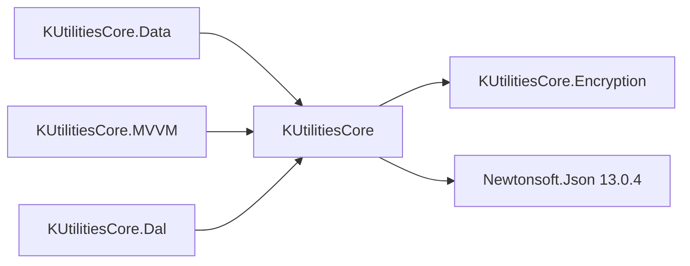

<!-- Mantenido por agentes según AGENTS.md. Puede regenerarse por completo con el prompt de Wiki. -->

# KUtilitiesCore

> Biblioteca base: validación fluida y por atributos, conversión de texto a tipos, extensiones (LINQ, reflexión, DataTable, strings), telemetría `IMetrics`, seguimiento de cambios y `ActionResult`.
> Referenciada por `KUtilitiesCore.Data`, `KUtilitiesCore.MVVM` y `KUtilitiesCore.Dal`. Sin punto de entrada único: se consume por namespace.

## 1. Descripción general y propósito

- Namespace raíz: `KUtilitiesCore`. Namespaces públicos: ver tablas de la sección 3 (`Data.*`, `Extensions`, `Extensions.Serialization`, `Helpers`, `IO`, `MVVM.ActionResult`, `OrderedInfo`, `Telemetry`, `Tracking`, `Tracking.Collection`, `Utils`).
- Rol: dependencia común de la solución. Referencian este proyecto: [KUtilitiesCore.Data](KUtilitiesCore.Data.md), [KUtilitiesCore.MVVM](KUtilitiesCore.MVVM.md) y [KUtilitiesCore.Dal](KUtilitiesCore.Dal.md) (el resto, de forma transitiva).
- Patrones evidenciados:

| Patrón | Ejemplo |
|---|---|
| Singleton con `Lazy<T>` | `Data/Converter/TypeConverterFactory.cs`, `Data/Validation/ValidationOptions.cs` |
| Fluent builder / reglas como extensiones | `Data/Validation/RuleBuilderExtensions.cs`, `Data/ImportDefinition/Validation/ImportRuleBuilder.cs` |
| Template method | `Data/Converter/Abstracts/NonNullableConverter.cs` (`InternalConvert`) |
| Composite y Null Object | `Telemetry/CompositeMetrics.cs`, `Telemetry/NullMetrics.cs` |
| Memento / `IEditableObject` | `Tracking/ChangeTrackingBase.cs` |
| Observer sobre colecciones | `Tracking/Collection/TrackedCollection.cs` |
| Result | `MVVM/ActionResult/ActionResult.cs` |

```text
KUtilitiesCore/
├── Data/             Converter/, DataAnnotations/, ImportDefinition/, Validation/, ValidationAttributes/
├── Extensions/       métodos de extensión (+ Serialization/)
├── Helpers/ IO/ Utils/   utilidades (Helpers es casi todo internal)
├── MVVM/ActionResult/    única parte de MVVM\ incluida en el .csproj
├── OrderedInfo/ Telemetry/ Tracking/    ordenamiento dinámico, IMetrics, seguimiento de cambios
└── Properties/       recursos .resx
```

## 2. Guía de inicio rápido

Sin registro DI ni claves de configuración. Se usa directamente (no hay extensiones de `IServiceCollection`).

**Validación fluida** (basado en `KUtilitiesCoreTests/Data/Validation/RuleBuilderTest.cs`):

```csharp
using System;
using KUtilitiesCore.Data.Validation;
using KUtilitiesCore.Data.Validation.Core;
using KUtilitiesCore.Data.Validation.RuleValues;

public sealed class Usuario
{
    public string Nombre { get; set; } = string.Empty;
    public string Genero { get; set; } = string.Empty;
    public int Edad { get; set; }
}

public sealed class UsuarioValidator : AbstractValidator<Usuario>
{
    private static readonly IRuleAllowedValue<string> Generos =
        new RuleAllowedStringValues(["Masculino", "Femenino"], StringComparison.OrdinalIgnoreCase);

    public UsuarioValidator()
    {
        RuleFor(u => u.Nombre).NotEmpty().Length(3, 50);
        RuleFor(u => u.Edad).GreaterThan(0).LessThan(120);
        RuleFor(u => u.Genero).NotEmpty().AllowedValues(Generos)
            .WithMessage("'{PropertyValue}' no es válido para '{PropertyName}'.");
    }
}

public static class EjemploValidacion
{
    public static bool Validar(Usuario usuario)
    {
        ValidationResult resultado = new UsuarioValidator().Validate(usuario);
        foreach (string mensaje in resultado.GetErrorMessages())
            Console.WriteLine(mensaje);
        return resultado.IsValid;
    }
}
```

**Conversión de texto a tipos** (registro global de un enum y lectura de un entero):

```csharp
using KUtilitiesCore.Data.Converter;

public enum Estado { Activo, Inactivo }

public static class EjemploConversion
{
    public static int? LeerEntero(string texto)
    {
        ITypeConverter<int> convertidor = TypeConverterFactory.Provider.Resolve<int>();
        return convertidor.TryConvert(texto, out int valor) ? valor : null;
    }

    public static Estado? LeerEstado(string texto)
    {
        ITypeConverterProvider proveedor = TypeConverterFactory.Provider;
        if (!proveedor.ContainsConverterType(typeof(Estado)))
            proveedor.AddEnum<Estado>();   // un registro duplicado lanza excepción

        return proveedor.Resolve<Estado>().TryConvert(texto, out Estado e) ? e : null;
    }
}
```

**Seguimiento de cambios** (basado en `KUtilitiesCoreTests/Tracking/ChangeTrackingBaseTests.cs`):

```csharp
using KUtilitiesCore.Tracking;

public sealed class Cliente : ChangeTrackingBase
{
    private string _nombre = string.Empty;

    public string Nombre
    {
        get => _nombre;
        set
        {
            _nombre = value;
            OnPropertyChanged(nameof(Nombre));
        }
    }
}

public static class EjemploTracking
{
    public static bool Probar()
    {
        var cliente = new Cliente { Nombre = "Ana" };
        cliente.BeginEdit();
        cliente.Nombre = "Beto";
        bool hayCambios = cliente.IsChanged;   // true
        cliente.CancelEdit();                  // restaura "Ana"
        return hayCambios && !cliente.IsChanged;
    }
}
```



## 3. Referencia del API principal

Sin miembros `[Obsolete]` ni `[Experimental]`. Sin bloques `extension` de C# 14: las extensiones usan la sintaxis clásica `this`.

### `KUtilitiesCore.Data`

| Tipo | Clase | Propósito |
|---|---|---|
| `DataErrorInfoExt` | static class | `GetErrorText`, `GetValidationResults`, `HasErrors` sobre objetos `IDataErrorInfo` |
| `IValidationErrorInfo` | interface | `IDataErrorInfo` ampliada: `HasValidationErrors`, `AddError`, `ClearErrorInfo`, `SetError` |
| `ValidationAttributesExt` | static class | `ValidateObject`, `ValidateProperty` con DataAnnotations |
| `ValidationErrorInfoBase` | abstract class | Base de `IValidationErrorInfo` (`Error`, indexador por columna) |

### `KUtilitiesCore.Data.Converter` (+ `.Abstracts`, `.Exceptions`, `.Types`)

| Tipo | Clase | Propósito |
|---|---|---|
| `ConverterByType` | delegate | `ITypeConverter ConverterByType(Type fieldType)` |
| `IArrayTypeConverter<T>` | interface | Convierte `string[]` o texto con `Separator` a colección |
| `ITypeConverter` / `ITypeConverter<T>` | interface | Conversión de `string` a tipo (`CanConvert`, `TryConvert`) |
| `ITypeConverterProvider` | interface | Registro y resolución de convertidores |
| `TypeConverterFactory` | class | Singleton: `Provider` |
| `BaseConverter<T>` | abstract class | Base de convertidores |
| `NonNullableConverter<T>` / `NullableConverter<T>` | abstract class | Plantillas con `InternalConvert` |
| `NullableInnerConverter<T>` | abstract class | Versión `T?` a partir de un `NonNullableConverter<T>` |
| `TypeConverterAlreadyRegisteredException` / `TypeConverterNotRegisteredException` | class | Errores de registro y resolución |
| `ArrayConverter<T>` | class | Arreglo de `T` con `Separator = ','` |
| `EnumConverter<T>` | class | Enum; ignora mayúsculas por defecto |

Convertidores de `bool`, numéricos, `DateTime`, `Guid`, `TimeSpan`, `string` y sus `Nullable*` son `internal` y vienen registrados.

### `KUtilitiesCore.Data.DataAnnotations`

| Tipo | Clase | Propósito |
|---|---|---|
| `DescriptionLocalizedAttribute` | class | Descripción desde recurso (`ResourceType`, `GetDescription()`) |
| `DisplayFormatLocalizedAttribute` | class | Formato desde recurso (`GetDataFormatString()`) |
| `DisplayNameLocalizedAttribute` | class | Nombre desde recurso (`GetDisplayName()`) |

### `KUtilitiesCore.Data.ImportDefinition` (+ `.Validation`, `.Validation.Rules`)

| Tipo | Clase | Propósito |
|---|---|---|
| `IFieldDefinitionItem` | interface | Campo importable: `FieldName`, `DisplayName`, `SourceColumnName`, `TargetType`, `AllowNull`, `IsUnique`, `DefaultValue`, `TypeConverter`, `ValidationRules`, `WithRules` |
| `FieldDefinitionItemBase` | abstract class | Base con metadatos desde `PropertyInfo` o valores explícitos |
| `FieldDefinitionItem` | class | Definición con `IsValidCustom`, `IsValidValueType`, `Clone` |
| `FieldDefinitionCollection` | class | `IReadOnlyList<FieldDefinitionItem>`; `Add`, `Add<T>`, `Remove`, `TryGetDefinition`, `Clone` |
| `IImportValidationRule` | interface | `IEnumerable<ValidationFailure> Validate(object? value, string fieldName)` |
| `ImportRuleBuilder` | class | `Rule`, `NotNull`, `Must<T>`, `GreaterThan`, `LessThan`, `GreaterThanOrEqualTo`, `LessThanOrEqualTo` |
| `ImportValidationRuleBase` | abstract class | Base de reglas |
| `ComparisonImportRule<T>` | class | Comparación (enum anidado `ComparisonOperator`) |
| `NotNullImportRule` / `PredicateImportRule<T>` | class | Reglas concretas |

### `KUtilitiesCore.Data.Validation` (+ `.Core`, `.RuleValues`)

| Tipo | Clase | Propósito |
|---|---|---|
| `AbstractValidator<T>` | abstract class | Base de validadores; `RuleFor`, `Custom` |
| `RuleBuilderExtensions` | static class | `NotEmpty`, `NotNull`, `Length`, `Matches`, `GreaterThan`, `LessThan`, `Must`, `AllowedValues`, `WithMessage` |
| `IRuleBuilderInitial<T,TProperty>` | interface | Inicio de cadena de `RuleFor` |
| `ValidationOptions` / `ValidationMode` | class / enum | `Instance.CascadeMode`; `CascadeMode`, `StopOnFirstFailure` |
| `IValidator<T>`, `IValidationRule<T>`, `IRuleBuilder<T,TProperty>` | interface | Contratos (`IRuleBuilder` es marcador vacío) |
| `ValidationContext<T>` | class | `InstanceToValidate` |
| `ValidationResult` | class | `Errors`, `IsValid`, `AddError`, `AddErrorMessage`, `GetErrorMessages` |
| `ValidationFailureBase` / `ValidationFailure` / `GenericFailure` | class | Fallos (propiedad, fila, valor intentado, código) |
| `IRuleValue`, `IRuleAllowedValue<T>` | interface | Valores permitidos |
| `BaseRuleValue`, `EmptyRuleValue` | class | Base y regla vacía |
| `RuleAllowedStringValues`, `RuleAllowedNumberRange<TNum>`, `RuleAllowedDateRange`, `RuleAllowedDataSource<TLookup>` | class | Conjuntos de valores permitidos |

### `KUtilitiesCore.Data.ValidationAttributes`

| Tipo | Clase | Propósito |
|---|---|---|
| `DateGreaterThanAttribute` / `DateLessThanAttribute` | class | Compara una fecha con otra propiedad (`AllowedEquality`) |
| `RequiredIfAttribute` | class | Requerido si `OtherProperty` == `TargetValue` |

### `KUtilitiesCore.Extensions` y `.Serialization`

| Tipo | Clase | Propósito |
|---|---|---|
| `CollectionExt` | static class | `ForEach` (con y sin índice) |
| `ColorExt` | static class | `ColorToHTML`, `HtmlToColor`, `GetContrastColor`, colores conocidos |
| `DataAnnotationsExt` | static class | Lectura de `Display*`/`Description` y atributos de propiedades |
| `DataTableExt` | static class | `MapTo<T>`, `ToDataTable`, `ToText`, `ToXml`, `GetColumns` |
| `DataTablePrettyExt` | static class | `PrintPretty` |
| `DateTimeExtensions` | static class | Meses por cultura, `LastDayOfMonth`, `CalculateDateDifference`, solapamiento de rangos |
| `DateRange`, `DateRangeOverlapResult`, `DateInterval`, `Quarter`, `RangePosition` | struct / class / enum | Rango de fechas, solapamiento y apoyo de `DateTimeExtensions` |
| `EnumsEx` | static class | Operaciones con banderas (`Add`, `Remove`, `SetFlag`) |
| `ExpressionsExt` | static class | Propiedades desde expresiones (`GetFullPathProperty`, `SetValue`, `GetPropertyValueOfPath`) |
| `GenericExt` | static class | `IsBetween`, `IsInRange`, `Intersect` |
| `IEnumerableExtensions` | static class | `Randomize`, `ShuffleInPlace`, `Chunk`, `ToHashSet` |
| `INotifyPropertychangedEx`, `PropertyChangedExtensions` | static class | `SetValueAndNotify`, `SetValue`, `RaisePropertyChanged` |
| `LinqExt`, `NumericValuesExt` | static class | `Transpose`; `AreConsecutive`, `Rollup` |
| `ObjectEx` | static class | `MapPropertiesTo`, `CreateDeepCopy` |
| `ReflectionExtensions`, `TypeExt` | static class | Reflexión sobre tipos y propiedades; `IsNullable`, `GetUnderlyingType` |
| `SecureStringExt` | static class | `ToSecureString` (devuelve `SecureString?`), `SecureCompare` |
| `StringExtensions` | static class | `ToNormalized`, `ToEnum<TEnum>`, `IsEqual`, `In`, Base64, `MakeValidFileName`, `ExpandToWords` |
| `TimeSpanExt` | static class | `ToReadableFormat` |
| `Utilities` (`.Serialization`) | static class | `ToJson`/`FromJson` (System.Text.Json), `ToXml`/`FromXml` |

### Resto de namespaces

| Tipo | Clase | Propósito |
|---|---|---|
| `ResourceHelpers` (`Helpers`), `StoreFolder`, `SpecialStoreFolder` (`IO`), `MemoryHelper` (`Utils`) | class / static class / enum | `GetFromResource<TResult>`; rutas de carpetas especiales; `CompactCurrentProcessWorkingSet` |
| `IActionResult`, `ActionResultBase`, `ActionResult`, `ActionResult<TResult>`, `ActionResultStatus`, `ActionResultExtensions` (`MVVM.ActionResult`) | interface / class / enum | Resultado de acción con estado `Empty`, `Succes`, `Faulted`, `Canceled` |
| `OrderedCollectionInfo`, `OrderedQueryableInfo`, `PropertyNameInfo`, `SortDirection` (`OrderedInfo`) | class / struct / enum | Ordenamiento dinámico serializable |
| `IMetrics`, `CompositeMetrics`, `LoggerMetrics`, `NullMetrics`, `MetricsExtensions` (`Telemetry`) | interface / class | Telemetría |
| `IChangeTrackingBase`, `ChangeTrackingBase`, `ChangeTrackerIgnoreAttribute` (`Tracking`) | interface / class | Seguimiento y reversión de cambios |
| `EntityTracked<T>`, `ITrackedCollection<T>`, `TrackedCollection<T>`, `TrackedStatus`, `TrackedStatusExtensions` (`Tracking.Collection`) | class / interface / enum | Colección que rastrea Added/Modified/Removed |

### Firmas clave

```csharp
// KUtilitiesCore.Data.Validation
public abstract class AbstractValidator<T> : IValidator<T>
{
    public ValidationResult Validate(T instance);
    public virtual ValidationResult Validate(ValidationContext<T> context);
    protected IRuleBuilderInitial<T, TProperty> RuleFor<TProperty>(Expression<Func<T, TProperty>> expression);
    protected void Custom(Action<T, ValidationContext<T>, List<ValidationFailure>> customValidationAction);
}

public static class RuleBuilderExtensions
{
    public static IRuleBuilder<T, string> NotEmpty<T>(this IRuleBuilderInitial<T, string> ruleBuilder);
    public static IRuleBuilder<T, TProperty> NotNull<T, TProperty>(this IRuleBuilderInitial<T, TProperty> ruleBuilder) where TProperty : class;
    public static IRuleBuilder<T, string> Length<T>(this IRuleBuilder<T, string> ruleBuilder, int min, int max);
    public static IRuleBuilder<T, TProperty> GreaterThan<T, TProperty>(this IRuleBuilder<T, TProperty> ruleBuilder, TProperty valueToCompare) where TProperty : struct, IComparable<TProperty>;
    public static IRuleBuilder<T, TProperty> LessThan<T, TProperty>(this IRuleBuilder<T, TProperty> ruleBuilder, TProperty valueToCompare) where TProperty : struct, IComparable<TProperty>;
    public static IRuleBuilder<T, TProperty> AllowedValues<T, TProperty>(this IRuleBuilder<T, TProperty> ruleBuilder, IRuleAllowedValue<TProperty> allowedValueDefinition);
    public static IRuleBuilder<T, TProperty> WithMessage<T, TProperty>(this IRuleBuilder<T, TProperty> ruleBuilder, string message);
}

public RuleAllowedStringValues(IEnumerable<string> allowedValues, StringComparison comparisonType = StringComparison.OrdinalIgnoreCase, bool allowNull = false, bool ignoreAcents = false);

// KUtilitiesCore.Data.Converter
public interface ITypeConverter { Type TargetType { get; } bool CanConvert(string value); object? TryConvert(string value); }
public interface ITypeConverter<TTargetType> : ITypeConverter { bool TryConvert(string value, out TTargetType result); }
public interface ITypeConverterProvider
{
    ITypeConverterProvider Add<TTargetType>(ITypeConverter<TTargetType> typeConverter);
    ITypeConverterProvider Add<TTargetType>(IArrayTypeConverter<TTargetType> typeConverter);
    ITypeConverterProvider AddEnum<TTargetType>() where TTargetType : struct, IConvertible;
    bool ContainsConverterType(Type targetType);
    ConverterByType? GetCustomConverter { get; set; }
    ITypeConverter Resolve(Type targetType);
    ITypeConverter<TTargetType> Resolve<TTargetType>();
    IArrayTypeConverter<TTargetType> ResolveCollection<TTargetType>();
}
public class TypeConverterFactory { public static ITypeConverterProvider Provider { get; } }

// KUtilitiesCore.Telemetry
public interface IMetrics
{
    void TrackMetric(string metricName, double value, IDictionary<string, string>? tags = null);
    void TrackExecutionTime(string metricName, long elapsedMilliseconds, IDictionary<string, string>? tags = null);
    void IncrementCounter(string metricName, int value = 1, IDictionary<string, string>? tags = null);
    void TrackException(Exception exception, IDictionary<string, string>? tags = null);
    void TrackEvent(string eventName, IDictionary<string, string>? properties = null, IDictionary<string, double>? metrics = null);
}
public static class MetricsExtensions
{
    public static void TimeAction(this IMetrics metrics, string metricName, Action action, IDictionary<string, string>? tags = null);
    public static Task<T> TimeActionAsync<T>(this IMetrics metrics, string metricName, Func<Task<T>> func, IDictionary<string, string>? tags = null);
    public static Task TimeActionAsync(this IMetrics metrics, string metricName, Func<Task> func, IDictionary<string, string>? tags = null);
}

// KUtilitiesCore.Tracking
public interface IChangeTrackingBase : IEditableObject { bool IsChanged { get; } }
public abstract class ChangeTrackingBase : INotifyPropertyChanged, IChangeTrackingBase
{
    public void BeginEdit(); public void CancelEdit(); public void EndEdit();
    protected virtual void OnPropertyChanged(string propertyName);
}
// TrackedCollection<TEntity> : ObservableCollection<TEntity>, TEntity : class, INotifyPropertyChanged
//   HasChanges, GetTrackedItem(entity), GetTrackedItems(), Begin/EndInsertUnmodifiedEntities()
public enum TrackedStatus { UnModified, Added, Modified, Removed }

// KUtilitiesCore.MVVM.ActionResult
public class ActionResult<TResult> : ActionResultBase
{
    public TResult? Result { get; set; }
    public static ActionResult<TResult> CreateSuccess(TResult? result);
    public static ActionResult<TResult> CreateFaulted(string message, Exception? exception = null);
}
public enum ActionResultStatus { Empty, Succes, Faulted, Canceled }   // sic: "Succes"
```

## 4. Dependencias y paquetes

| Paquete | Versión | Uso en este proyecto |
|---|---|---|
| `Newtonsoft.Json` | 13.0.4 | Ramas condicionales (`#else` de `NET6_0_OR_GREATER`, `NETFRAMEWORK`) y `using Newtonsoft.Json.Linq` en `IFieldDefinitionItem.cs` y `RuleBuilderExtensions.cs`; para `net10.0` el código usa `System.Text.Json` |

- Versiones tomadas del `.csproj`: no existe `Directory.Packages.props`.
- Referencias a proyectos: [KUtilitiesCore.Encryption](KUtilitiesCore.Encryption.md).
- `FrameworkReference`: ninguna. Analizadores: ninguno configurado.
- Recursos embebidos localizados (`es` por defecto y `en-US`): `Data/ValidationAttributes/ValidationAtrributesStrings*.resx`, `Extensions/ColorExtLocalizable*.resx`, `Properties/Resources.resx`.

## 5. Reglas de arquitectura y restricciones

| Regla | Evidencia |
|---|---|
| `Nullable` = `enable`, `ImplicitUsings` = `enable`, `LangVersion` = `latest` | `KUtilitiesCore/KUtilitiesCore.csproj` |
| Comentarios XML en español; `GenerateDocumentationFile=True` | `KUtilitiesCore.csproj`, `AGENTS.md` |
| Reglas de validación como métodos de extensión; `IRuleBuilder<,>` es un marcador sin miembros | `Data/Validation/Core/IRuleBuilder.cs`, `Data/Validation/RuleBuilderExtensions.cs` |
| Singletons por `Lazy<T>` o campo estático: `TypeConverterFactory.Provider`, `ValidationOptions.Instance`, `NullMetrics.Instance` | `TypeConverterFactory.cs`, `ValidationOptions.cs`, `NullMetrics.cs` |
| Errores de conversión por excepciones propias | `Data/Converter/Exceptions/*.cs`, `TypeConverterProvider.cs` |
| Async solo en `TimeActionAsync` (`Task`/`Task<T>`), sin `CancellationToken` | `Telemetry/MetricsExtensions.cs` |
| Sin `ILogger` ni extensiones de `IServiceCollection`; la telemetría usa `IMetrics` | `Telemetry/LoggerMetrics.cs`, `KUtilitiesCore.csproj` |
| Código multi-TFM heredado con `#if NET6_0_OR_GREATER` / `NETFRAMEWORK` | `Extensions/Serialization/Utilities.cs`, `Extensions/ObjectEx.cs`, `Extensions/IEnumerableExtensions.cs` |
| Sin `InternalsVisibleTo`; los tipos `internal` no se prueban directamente | `AGENTS.md` |
| Carpetas y archivos excluidos de la compilación: `Data/DataImporter/**`, `Diagnostics/**`, `MVVM/**` (salvo `MVVM/ActionResult/*`), `Data/ImportDefinition/IFieldValidation.cs`, `Data/ImportDefinition/ImportedFieldValue.cs`, `OrderedInfo/PNameInfo.cs` | `KUtilitiesCore.csproj` |

**Qué NO hacer**

| Prohibición | Evidencia |
|---|---|
| No implementar `IRuleBuilder<,>` ni `IRuleBuilderInitial<,>` fuera del proyecto: las extensiones convierten (cast) al `RuleBuilder<,>` interno | `Data/Validation/RuleBuilderExtensions.cs` |
| No usar `GreaterThan`/`LessThan` de `RuleBuilderExtensions` con tipos de referencia: exigen `struct, IComparable<T>` | `Data/Validation/RuleBuilderExtensions.cs` |
| No instanciar `TypeConverterProvider` (es `internal`): usar `TypeConverterFactory.Provider` | `Data/Converter/TypeConverterProvider.cs`, `TypeConverterFactory.cs` |
| No registrar dos veces el mismo tipo ni resolver tipos sin registrar sin comprobar `ContainsConverterType`: `Add`/`AddEnum`/`Resolve` lanzan excepción. `Add(ITypeConverter<T>)` duplicado lanza `TypeConverterNotRegisteredException` (mensaje "Duplicate…"); `Add(IArrayTypeConverter<T>)` duplicado lanza `TypeConverterAlreadyRegisteredException` | `Data/Converter/TypeConverterProvider.cs` |
| No escribir `ActionResultStatus.Success`: el miembro se llama `Succes` | `MVVM/ActionResult/ActionResultStatus.cs` |
| No esperar las sobrecargas Newtonsoft de `ToJson`/`FromJson` en `net10.0`: están bajo `#else` | `Extensions/Serialization/Utilities.cs` |
| No importar `KUtilitiesCore.Extensions` y `KUtilitiesCore.Encryption.Extensions` a la vez para llamar `"x".ToSecureString()`: existen dos métodos de extensión con la misma firma de entrada | `Extensions/SecureStringExt.cs`, `KUtiitiesCore.Encryption/Extensions/StringExt.cs` |
| No añadir código en carpetas excluidas del `.csproj` esperando que compile | `KUtilitiesCore.csproj` |

**Puntos de extensión**

- Conversor nuevo: heredar `NonNullableConverter<T>` (implementar `InternalConvert`) o `NullableInnerConverter<T>`; registrar con `TypeConverterFactory.Provider.Add(...)` o asignar `GetCustomConverter`.
- Validador nuevo: heredar `AbstractValidator<T>`; usar `Custom(...)` para reglas de objeto.
- Valores permitidos nuevos: heredar `BaseRuleValue` e implementar `IRuleAllowedValue<T>`.
- Regla de importación nueva: heredar `ImportValidationRuleBase` y añadirla con `ImportRuleBuilder.Rule(...)`.
- Métricas nuevas: implementar `IMetrics` y combinarlas con `CompositeMetrics`.
- Entidades con reversión: heredar `ChangeTrackingBase`; excluir propiedades con `[ChangeTrackerIgnore]`.
