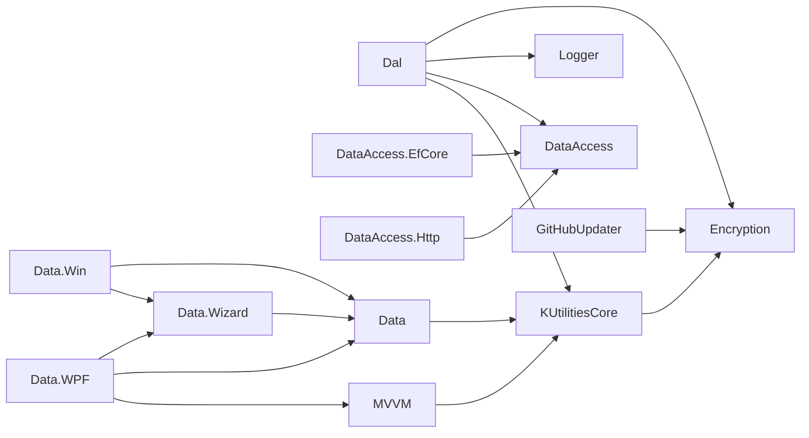

# KUtilitiesCore: wiki técnica de la solución

<!-- Mantenido por agentes según AGENTS.md. Puede regenerarse por completo con el prompt de Wiki. -->

> Índice de la documentación técnica de la solución `KUtilitiesCore.sln`: 14 proyectos de producción documentados (uno por archivo) y 9 proyectos de pruebas, que no tienen wiki propia.
> Cada wiki sigue la misma plantilla de cinco secciones (descripción, inicio rápido, API, dependencias, reglas) y describe únicamente lo que existe en el código.

## Proyectos

| Proyecto | Tipo | TFM | Propósito | Wiki |
|---|---|---|---|---|
| `KUtilitiesCore` | Biblioteca | net10.0 | Base: validación, conversión, extensiones, telemetría `IMetrics`, definición de importación | [KUtilitiesCore](KUtilitiesCore.md) |
| `KUtilitiesCore.Dal` | Biblioteca | net10.0 | Acceso a datos ADO.NET para SQL Server: contexto, Unit of Work, mapeo de readers, carga masiva | [KUtilitiesCore.Dal](KUtilitiesCore.Dal.md) |
| `KUtilitiesCore.Data` | Biblioteca | net10.0 | Importación y exportación CSV y Excel sobre `DataTable` | [KUtilitiesCore.Data](KUtilitiesCore.Data.md) |
| `KUtilitiesCore.Data.WPF` | Biblioteca WPF | net10.0-windows | Asistente de importación, exportación y mensajes para WPF | [KUtilitiesCore.Data.WPF](KUtilitiesCore.Data.WPF.md) |
| `KUtilitiesCore.Data.Win` | Biblioteca WinForms | net10.0-windows | Asistente de importación y exportación para Windows Forms | [KUtilitiesCore.Data.Win](KUtilitiesCore.Data.Win.md) |
| `KUtilitiesCore.Data.Wizard` | Biblioteca | net10.0 | Orquestación del asistente de importación, agnóstica de UI | [KUtilitiesCore.Data.Wizard](KUtilitiesCore.Data.Wizard.md) |
| `KUtilitiesCore.DataAccess` | Biblioteca | netstandard2.1 | Abstracciones: Unit of Work, repositorios, Specification, paginación | [KUtilitiesCore.DataAccess](KUtilitiesCore.DataAccess.md) |
| `KUtilitiesCore.DataAccess.EfCore` | Biblioteca | net10.0 | Implementación de DataAccess sobre Entity Framework Core | [KUtilitiesCore.DataAccess.EfCore](KUtilitiesCore.DataAccess.EfCore.md) |
| `KUtilitiesCore.DataAccess.Http` | Biblioteca | net10.0 | Implementación de DataAccess sobre una API REST | [KUtilitiesCore.DataAccess.Http](KUtilitiesCore.DataAccess.Http.md) |
| `KUtilitiesCore.Encryption` | Biblioteca | net10.0 | Cifrado AES/Base64, DPAPI condicional y hash de contraseñas | [KUtilitiesCore.Encryption](KUtilitiesCore.Encryption.md) |
| `KUtilitiesCore.GitHubUpdater` | Biblioteca | net10.0 | Actualización desde releases de GitHub y reporte de issues | [KUtilitiesCore.GitHubUpdater](KUtilitiesCore.GitHubUpdater.md) |
| `KUtilitiesCore.Logger` | Biblioteca | netstandard2.0 | Proveedores de logging (archivo, SQL Server, depuración) | [KUtilitiesCore.Logger](KUtilitiesCore.Logger.md) |
| `KUtilitiesCore.MVVM` | Biblioteca | net10.0 | Núcleo MVVM: ViewModels, comandos, enlace de eventos | [KUtilitiesCore.MVVM](KUtilitiesCore.MVVM.md) |
| `KUtilitiesCore.MVVM.Messaging` | Biblioteca | net10.0 | Bus de mensajes en memoria con referencias débiles | [KUtilitiesCore.MVVM.Messaging](KUtilitiesCore.MVVM.Messaging.md) |

Rutas de carpeta que difieren del nombre del proyecto: `KUtiitiesCore.Encryption/` (Encryption) y `KUtilities.Logger/` (Logger).

## Grafo de referencias directas

Una flecha `A --> B` significa que A tiene un `ProjectReference` a B (según los `.csproj`). `KUtilitiesCore.DataAccess`, `KUtilitiesCore.Encryption`, `KUtilitiesCore.Logger` y `KUtilitiesCore.MVVM.Messaging` no referencian otros proyectos.

`KUtilitiesCore.MVVM.Messaging` es un nodo aislado: no tiene referencias entrantes de otros proyectos de producción (solo de `KUtilitiesCore.MVVMTests`). Por no tener aristas, no se dibuja en el grafo; el total real es de 14 proyectos de producción.

## Convenciones globales

| Convención | Detalle | Evidencia |
|---|---|---|
| SDK fijado | .NET SDK `10.0.401`, `rollForward: latestFeature` | `global.json` |
| Ejecutor de pruebas | `Microsoft.Testing.Platform` | `global.json` |
| Lenguaje | `LangVersion` = `latest` en todos los proyectos (C# 14 con el SDK fijado) | `*/*.csproj` |
| Configuración por proyecto | No existen `Directory.Build.props`, `Directory.Packages.props` ni `.editorconfig` en la raíz; cada `.csproj` declara sus propios paquetes y versiones | Listado de la raíz de la solución |
| Nulabilidad | `Nullable enable` salvo `KUtilitiesCore.DataAccess` y `KUtilitiesCore.DataAccess.Http` (`disable`); `Logger` es `enable` | `*/*.csproj` |
| Documentación XML | `GenerateDocumentationFile=True` en la mayoría de bibliotecas (no declarado en `DataAccess.Http`) | `*/*.csproj` |
| Empaquetado | `GeneratePackageOnBuild=False` explícito en varios proyectos; los demás usan el valor por defecto | `*/*.csproj` |
| Multi-TFM | `net10.0`, `net10.0-windows` (WinForms y WPF), `netstandard2.0` (Logger) y `netstandard2.1` (DataAccess) | `*/*.csproj` |
| Código excluido | Los `Compile Remove` de los csproj mandan sobre las carpetas: `Dal` (`Paging`, `SPHelper` y cuatro archivos de UOW/excepciones) y `Data` (`DataImporter\Helpers`) | `KUtilitiesCore.Dal/*.csproj`, `KUtilitiesCore.Data/*.csproj` |
| Errores ortográficos como API | Se conservan tal cual: `GetHashServise`, `DPAPIEncryptServise`, `GetUniqueDerivedkey`, `Succes`, `Sucess`, `SpliterChar`, `defaulFilename`, carpeta `KUtiitiesCore.Encryption`, namespaces `Infraestructure` / `Infrastructure` | Wikis de cada proyecto |

## Proyectos de pruebas detectados (sin wiki propia)

Se leyeron solo para extraer ejemplos de uso.

| Proyecto | Ejecutor | TFM | Proyectos probados |
|---|---|---|---|
| `KUtilitiesCoreTests` | MSTest 4.4.1 (MTP) | net10.0 | `KUtilitiesCore`, `KUtilitiesCore.Data` |
| `KUtilitiesCore.DataAccessTests` | MSTest 4.4.1 (MTP) | net10.0 | `KUtilitiesCore.Dal` |
| `KUtilitiesCore.DataTests` | MSTest 4.4.1 (MTP) | net10.0 | `KUtilitiesCore.Data`, `KUtilitiesCore` |
| `KUtilitiesCore.Data.WinTests` | MSTest 4.4.1 (MTP) | net10.0-windows | `KUtilitiesCore.Data.Win` |
| `KUtilitiesCore.Data.WPFTests` | MSTest 4.4.1 (MTP) | net10.0-windows | `KUtilitiesCore.Data.WPF`, `Data.Wizard`, `Data` |
| `KUtilitiesCore.GitHubUpdaterTests` | MSTest 4.4.1 (MTP) | net10.0 | `KUtilitiesCore.GitHubUpdater` |
| `KUtilitiesCore.LoggerTests` | MSTest 4.4.1 (MTP) | net10.0 | `KUtilitiesCore.Logger` |
| `KUtilitiesCore.MVVMTests` | MSTest 4.4.1 (MTP) | net10.0 | `KUtilitiesCore.MVVM`, `KUtilitiesCore.MVVM.Messaging` |
| `KUtilitiesCore.MVVMTests.EventCommandBinder` | xunit.v3 4.0.1 | net10.0 | `KUtilitiesCore.MVVM` |

No hay proyectos de pruebas para `KUtilitiesCore.DataAccess.EfCore`, `KUtilitiesCore.DataAccess.Http` ni `KUtilitiesCore.Encryption` (No determinado si se prueban de forma indirecta).

## Supuestos y lagunas

- **Fuente de verdad.** Los `.csproj` y el código prevalecen sobre `AGENTS.md` y los `README.md` de cada proyecto, que se trataron como datos y se citaron solo cuando el código los confirma.
- **Cadena de dependencias de `AGENTS.md`.** Indica `MVVM → MVVM.Messaging`, pero los `.csproj` no contienen esa referencia (`MVVM.Messaging` no referencia a nadie). Las wikis usan las referencias reales.
- **Paginación en `DataAccess`.** `AGENTS.md` afirma que `Paging/` está excluido de la compilación en `Dal` y `DataAccess`. En el código, solo `Dal` lo excluye; `KUtilitiesCore.DataAccess` no tiene `Compile Remove` y compila `Paging/`.
- **`SkipPagination`.** Su nombre y comentario ("omitir la paginación") contradicen su uso en `SpecificationEvaluator` de EfCore, que pagina solo cuando vale `true`. No determinado si es intencional.
- **DPAPI en `Encryption`.** `GetDPAPIEncryptionService` y `DPAPIEncryptServise` quedan bajo directivas condicionales (`WINDOWS` / `windows`) que ningún `.csproj` define; no forman parte del API compilado.
- **`Newtonsoft.Json` en `KUtilitiesCore`.** Está referenciado, pero para `net10.0` el código usa `System.Text.Json`; las sobrecargas Newtonsoft de `ToJson`/`FromJson` están bajo `#else` y no se compilan.
- **Paquetes sin uso verificado.** `Microsoft.Extensions.Http.Polly` en `DataAccess.Http` no se usa en el código fuente.
- **Clave embebida.** `AppUpdateInfo` (GitHubUpdater) usa una clave AES literal por defecto. Su valor no se reproduce en esta wiki.
- **Comportamiento de `Dal` según `AGENTS.md`.** Los contratos del hook `OnConnectionOpened` y de `SaveChanges` se documentaron solo con lo visible en el código y sus comentarios XML; el detalle completo de los valores devueltos por `DaoUnitOfWork.SaveChanges` no se repite en la wiki.
- **Entorno de ejecución.** Nada se compiló ni ejecutó: los ejemplos se escribieron contra los miembros públicos leídos en el código, no contra una compilación real.
- **Archivos preexistentes en `docs/`.** `openspec-tasks-mandatory-steps.md` y la carpeta `superpowers/` ya existían; no se modificaron ni forman parte de esta wiki.
- **Seguridad.** No se leyeron `secrets.json`, `.env`, `*.pfx` ni `*.snk`; tampoco `*.csproj.user`. Las configuraciones de ejemplo usan valores ficticios o `<redacted>`.
